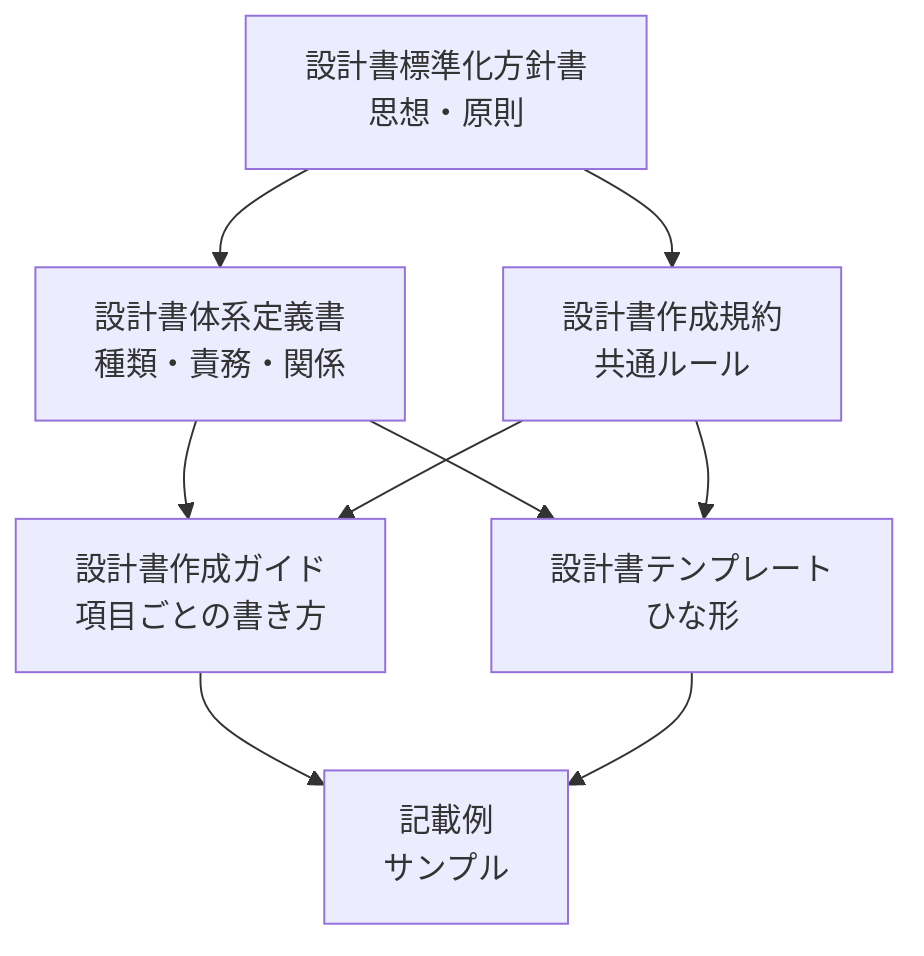
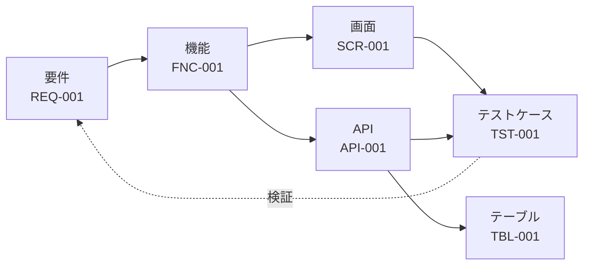
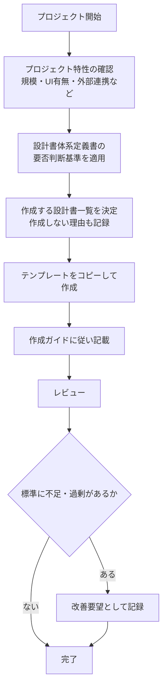
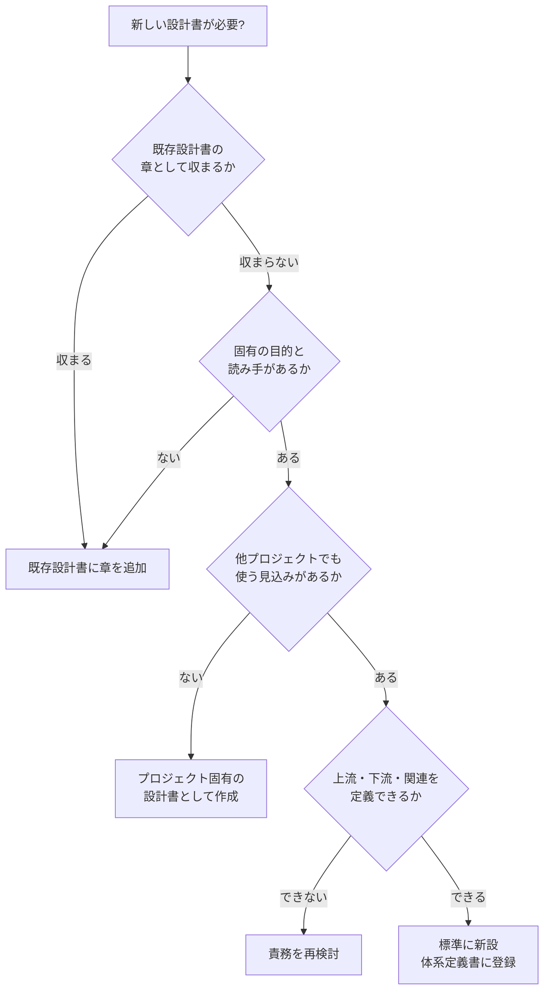

# 設計書標準化方針書

## 1. 目的

本書は、システム開発で作成する設計書一式（以下「設計書標準」）を、どのような考え方・原則に基づいて構築し、運用・改善していくかを定義する。

設計書標準は、単なるテンプレート集ではなく、次の状態を実現するための「開発標準の基盤」と位置付ける。

- プロジェクトが変わっても、同じ考え方・同じ品質で設計書を作成できる。
- 必要な設計書を、必要な粒度で、迷わず選択できる。
- 要件から設計、実装、テストまでを一貫して追跡できる。
- 個人開発から複数人のチーム開発まで、そのまま拡張して利用できる。

## 2. 適用範囲

| 項目 | 内容 |
|------|------|
| 対象工程 | 企画・要件定義、基本設計、詳細設計、テスト、運用・保守 |
| 対象システム | Webアプリ、業務システム、API／バッチ、モバイルアプリ等。特定の種類に限定しない |
| 対象規模 | 個人開発の小規模案件から、複数チームによる大規模案件まで |
| 対象読者 | 設計書の作成者、レビュー者、実装者、テスト担当者、保守担当者 |
| 対象外 | プロジェクト管理文書（WBS、議事録、課題管理表など）、各言語のコーディング規約 |

## 3. 設計書標準の構成

設計書標準は、次の4分類・5種類のドキュメントで構成する。

| 分類 | ドキュメント | 役割 | 問いに答える |
|------|--------------|------|--------------|
| 標準定義 | 設計書標準化方針書（本書） | 設計書全体の思想・原則・運用方針を定義する | なぜ、どのような考え方で作るのか |
| 標準定義 | 設計書体系定義書 | 設計書の種類・責務・関係性・要否判断を定義する | どの設計書が必要で、何を定義するのか |
| 標準定義 | 設計書作成規約 | 全設計書に共通する記載・命名・管理のルールを定義する | どのようなルールで書くのか |
| ガイド | 設計書作成ガイド | 各設計書の項目ごとの記載内容・粒度・判断基準を説明する | 各項目に何をどこまで書くのか |
| テンプレート | 設計書テンプレート／記載例 | 実際にコピーして使うひな形と、その記入例 | 実際にどう書くのか |

上位のドキュメントは下位のドキュメントの判断基準となる。下位のドキュメントが上位と矛盾する場合は、上位を正とし、下位を修正する。

## 4. 基本方針

設計書標準は、以下の8つの基本方針に従う。各方針には、判断に迷ったときの具体的な指針を併記する。

### 方針1：技術非依存

特定のプログラミング言語、フレームワーク、クラウド、製品に依存しない。

- 設計書には「何を実現するか（What）」を記載し、技術固有の「どう実装するか（How）」は詳細設計以降に限定する。
- 技術固有の情報が必要な場合は、テンプレート本体ではなく「技術別の補足項目」として分離する。
- 例：「認証方式：トークンベース認証」は基本設計に書いてよいが、「ライブラリ名・設定値」は詳細設計に書く。

### 方針2：規模への適応性（スケーラビリティ）

小規模から大規模まで、同じ体系のまま対応できるようにする。

- 設計書は「必須」「条件付き必須」「任意」に分類し、規模や特性に応じて選択する（詳細は設計書体系定義書）。
- 小規模案件では、複数の設計書を1ファイルに統合してよい。ただし、章立ては元の設計書の構成を維持し、後で分割できるようにする。
- 大規模案件では、1つの設計書をサブシステムや機能単位に分割してよい。

### 方針3：選択的利用

すべての設計書を作ることを目的にしない。プロジェクトに必要な設計書だけを選択して利用する。

- プロジェクト開始時に、設計書体系定義書の「要否判断基準」に従って作成する設計書を決定し、その結果を記録する。
- 作成しないと判断した設計書についても、その理由を記録する。

### 方針4：単一情報源（重複の最小化）

1つの情報は1か所でのみ定義し、他の設計書からは参照する（Single Source of Truth）。

- 各情報の「正（マスター）」となる設計書を設計書体系定義書で定める。
- 他の設計書で同じ情報が必要な場合は、内容を転記せず、ID またはリンクで参照する。
- やむを得ず転記する場合は、転記元を明記する。

### 方針5：追跡可能性（トレーサビリティ）

要件・設計・テストを ID で相互に結び付け、双方向に追跡できるようにする。

- 要件、機能、画面、API、テーブル、テストケースなどには、すべて一意の ID を付与する。
- 下流の成果物は、根拠となる上流の ID を必ず記載する。
- これにより、「この要件はどこで実現され、どのテストで確認されるか」「この変更はどこに影響するか」を追跡できる状態を保つ。

### 方針6：保守性・拡張性

設計書は「作って終わり」ではなく、システムとともに保守され続けるものとして設計する。

- 設計書はテキスト形式（Markdown）で作成し、Git でバージョン管理する。
- 図はテキストで記述できる形式（Mermaid）を基本とし、差分を確認できるようにする。
- 実装と乖離した設計書は誤りの原因となるため、変更時は設計書の更新を同時に行う。

### 方針7：読み手中心

設計書は書き手のためではなく、読み手（実装者・テスト担当者・将来の保守担当者）のために書く。

- 前提知識がない読み手でも理解できるよう、用語は用語集で定義し、略語を多用しない。
- 結論・概要を先に書き、詳細はその後に書く。
- 文章より表・図で表現できるものは、表・図を優先する。

### 方針8：継続的改善

設計書標準そのものも、実際のプロジェクトへの適用を通じて改善する。

- 適用時に見つかった不足・過剰・分かりにくさは、改善要望として記録する。
- 標準の変更は「6. 設計書標準の運用」に従い、バージョンを上げて管理する。

## 5. 設計書を構成する考え方

### 5.1 工程と抽象度

設計書は、工程が進むにつれて「何を（What）」から「どのように（How）」へと抽象度を下げていく。

| 工程 | 主な関心 | 書く内容 | 書かない内容 |
|------|----------|----------|--------------|
| 要件定義 | なぜ・何を | 業務上の目的、要件、制約 | 画面レイアウト、実装方式 |
| 基本設計 | 何を（外部から見た振る舞い） | 画面・API・データの外部仕様、システム構成 | 内部処理の手順、クラス構造 |
| 詳細設計 | どのように（内部の仕組み） | 内部処理、モジュール構成、物理設計 | 業務上の目的の再説明 |
| テスト | どう確かめるか | テスト観点、テストケース、期待結果 | 設計の再記述 |
| 運用 | どう動かし続けるか | 運用手順、監視、障害対応 | 機能仕様の再記述 |

### 5.2 基本設計と詳細設計の境界

基本設計と詳細設計の境界は、次の判断基準で決める。

| 判断基準 | 基本設計に書く | 詳細設計に書く |
|----------|----------------|----------------|
| 誰が関心を持つか | 利用者・発注者・他システム | 開発者 |
| 外部から観測できるか | できる（入出力、画面表示、エラー応答） | できない（内部ロジック、内部データ構造） |
| 技術選定に依存するか | 依存しない | 依存する |
| 変更時に合意が必要か | 利用者・関係者の合意が必要 | 開発チーム内で判断できる |

小規模案件では、基本設計と詳細設計を1つの設計書に統合してよい。その場合も、上記の区分が分かるよう章を分ける。

## 6. 設計書標準の運用

### 6.1 プロジェクトへの適用手順

### 6.2 テイラリング（標準のカスタマイズ）

プロジェクト固有の事情で標準と異なる運用をする場合は、次のルールに従う。

| 区分 | 可否 | 条件 |
|------|------|------|
| 設計書の省略 | 可 | 要否判断基準で「任意」または条件に該当しないもの。理由を記録する |
| 設計書の統合 | 可 | 章立てを維持し、後で分割できる形にする |
| 設計書の分割 | 可 | 分割単位と命名を規約に従って定める |
| 項目の追加 | 可 | 追加理由を記録し、汎用性があれば標準への反映を検討する |
| 必須項目の削除 | 原則不可 | 削除する場合は理由を記録する |
| ID体系・命名規則の変更 | 原則不可 | 追跡可能性が損なわれるため |

### 6.3 設計書標準の変更管理

| 項目 | 内容 |
|------|------|
| 管理方法 | Git リポジトリで管理し、変更はコミット履歴で追跡する |
| バージョン | セマンティックバージョニング（例：1.2.0）を採用する |
| メジャー更新 | 体系の変更、ID体系の変更など、既存設計書に影響する変更 |
| マイナー更新 | 設計書・項目の追加など、後方互換性のある変更 |
| パッチ更新 | 誤字修正、表現の改善など |
| 変更履歴 | 各ドキュメントの末尾に変更履歴を記載する |

## 7. 設計書の新設・統合・廃止の判断基準

設計書を新しく追加する、既存の設計書と統合する、または廃止する場合は、次の基準で判断する。

### 7.1 新設の判断基準

次の **すべて** を満たす場合に、新しい設計書を追加する。

| No | 判断基準 | 確認内容 |
|----|----------|----------|
| 1 | 固有の目的がある | 既存の設計書のどれにも属さない目的・責務を持つか |
| 2 | 独立した読み手がいる | その情報を必要とする読み手・利用場面が明確か |
| 3 | 既存設計書に収まらない | 既存設計書の章として追加すると、その設計書の責務が曖昧になるか |
| 4 | 再利用性がある | 特定の1プロジェクトだけでなく、他のプロジェクトでも使う見込みがあるか |
| 5 | 体系上の位置付けが明確 | 入力情報（上流）・出力情報（下流）・関連設計書を定義できるか |

基準4を満たさない場合は、標準には追加せず、プロジェクト固有の設計書として扱う。

### 7.2 統合の判断基準

次のいずれかに該当する場合は、統合を検討する。

- 2つの設計書で記載内容の大部分が重複している。
- 一方の設計書が単独で作成されることがほとんどない。
- 2つの設計書の読み手と更新タイミングが常に同じである。

### 7.3 廃止の判断基準

次のいずれかに該当する場合は、廃止を検討する。

- 複数のプロジェクトで継続して「作成不要」と判断されている。
- 記載内容が他の設計書やツール（ソースコード、自動生成ドキュメント等）で代替されている。

廃止する場合も、体系定義書から削除せず「廃止」ステータスとし、代替先を記載する。

## 8. 用語

| 用語 | 定義 |
|------|------|
| 設計書標準 | 本書を含む、設計書の作成に関する方針・体系・規約・ガイド・テンプレートの総称 |
| 設計書 | システムの要件・仕様・構造・テストなどを記述した成果物 |
| テンプレート | プロジェクト固有の情報を含まない、設計書のひな形 |
| テイラリング | プロジェクトの特性に合わせて標準を調整すること |
| 追跡可能性 | 要件・設計・テストを ID で関連付け、相互にたどれる性質 |
| 単一情報源 | 1つの情報を1か所でのみ定義し、他からは参照する原則 |
| TBD | To Be Determined。未確定事項を示す記号 |

## 9. 関連資料

| ID | 資料名 | 関係 |
|----|--------|------|
| STD-002 | 設計書体系定義書 | 本書の方針に基づき、設計書の種類・責務・関係を定義する |
| STD-003 | 設計書作成規約 | 本書の方針に基づき、共通の記載・管理ルールを定義する |

## 10. 変更履歴

| バージョン | 日付 | 変更内容 | 変更者 |
|------------|------|----------|--------|
| 0.1.0 | 2026-11-23 | 初版作成（ドラフト） | — |
