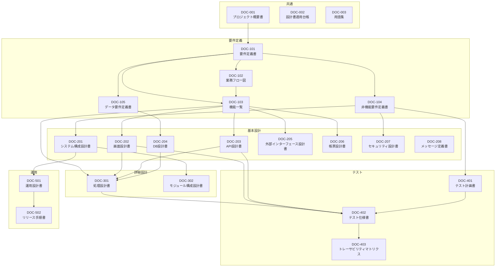
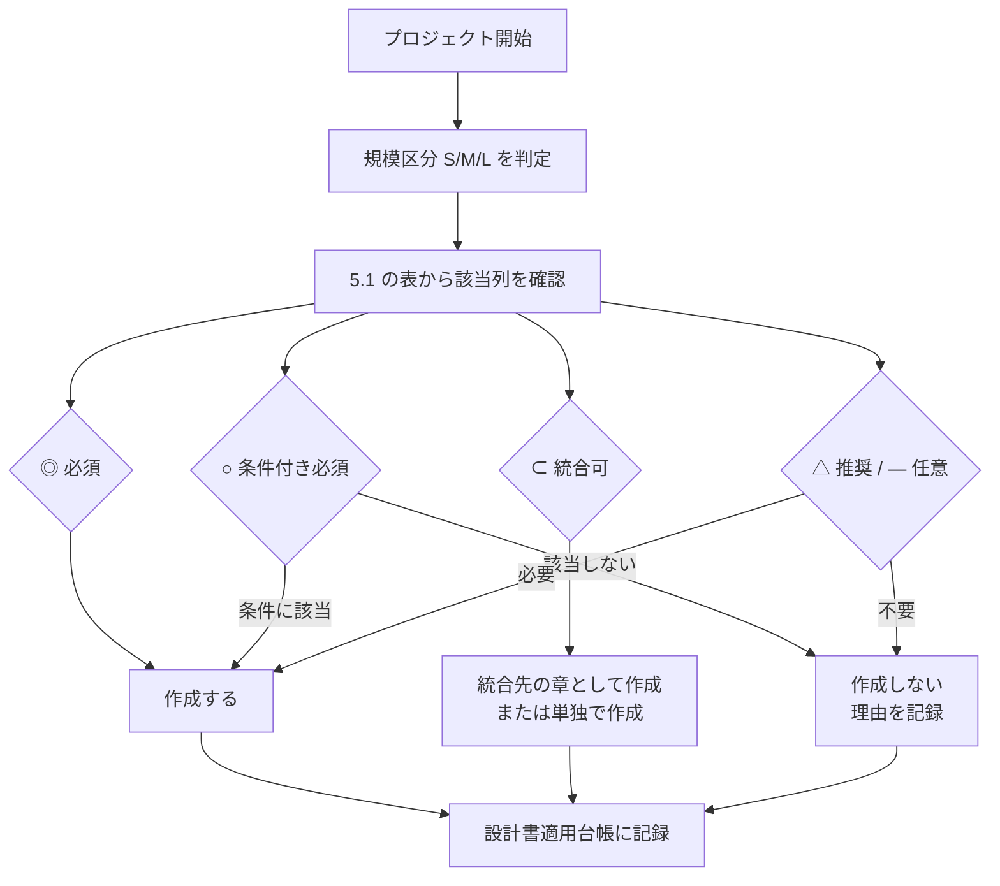
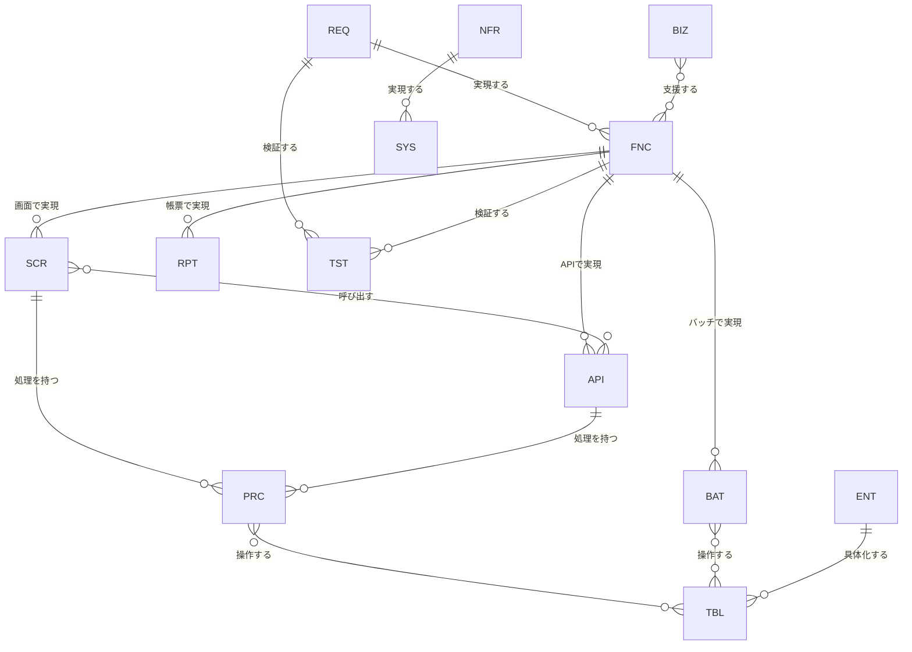

# 設計書体系定義書

## 1. 目的

本書は、設計書標準に含まれる各設計書について、次の事項を定義する。

- どのような設計書があるか（設計書一覧）
- 各設計書が何を定義し、何を定義しないか（責務）
- 設計書同士がどのように関係するか（入力・出力・関連）
- どの情報をどの設計書が正として管理するか（情報の所在）
- プロジェクトでどの設計書を作成するか（要否判断基準）

本書は、設計書の追加・統合・廃止を検討する際の基準台帳としても使用する。判断基準そのものは「設計書標準化方針書（STD-001）7章」に従う。

## 2. 設計書体系の全体像

### 2.1 工程別の体系



### 2.2 情報の流れ（簡略図）

```text
プロジェクト概要書
       │
       ▼
   要件定義書 ──── 業務フロー図
       │
       ├── 機能一覧
       │      ├── 画面設計書 ─────┐
       │      ├── API設計書 ──────┤
       │      ├── 外部IF設計書 ───┼── 処理設計書
       │      └── 帳票設計書 ─────┘
       │
       ├── 非機能要件定義書
       │      ├── システム構成設計書 ── モジュール構成設計書
       │      └── セキュリティ設計書
       │
       └── データ要件定義書
              └── DB設計書

各設計書 ──▶ テスト計画書 ──▶ テスト仕様書 ──▶ トレーサビリティマトリクス
システム構成設計書 ──▶ 運用設計書 ──▶ リリース手順書
```

### 2.3 横断的な設計書

次の設計書は、特定の工程に属さず、全工程で参照・更新される。

| 設計書 | 役割 |
|--------|------|
| DOC-001 プロジェクト概要書 | すべての設計書の前提（目的・範囲・制約）を提供する |
| DOC-002 設計書適用台帳 | 本プロジェクトで作成する設計書と、その状態を管理する |
| DOC-003 用語集 | 全設計書で使う用語の意味を統一する |
| DOC-208 メッセージ定義書 | 画面・API・バッチで共通利用するメッセージを一元管理する |
| DOC-403 トレーサビリティマトリクス | 要件〜設計〜テストの対応関係を一覧化する |

## 3. 設計書ID体系

設計書の種類を表す ID（DOC-xxx）は、工程ごとに番号帯を割り当てる。

| 番号帯 | 工程 | 備考 |
|--------|------|------|
| DOC-0xx | 共通 | 全工程で使用 |
| DOC-1xx | 要件定義 | |
| DOC-2xx | 基本設計 | |
| DOC-3xx | 詳細設計 | |
| DOC-4xx | テスト | |
| DOC-5xx | 運用・保守 | |
| DOC-9xx | プロジェクト固有 | 標準に含めない、プロジェクト独自の設計書 |

番号は一度割り当てたら再利用しない。廃止した設計書の番号も欠番として残す。

設計書の中で定義される要素（機能、画面、API など）の ID 体系は、「設計書作成規約（STD-003）」で定義する。

## 4. 要否区分と規模区分

### 4.1 要否区分

| 区分 | 記号 | 意味 |
|------|------|------|
| 必須 | ◎ | 規模・特性にかかわらず作成する |
| 条件付き必須 | ○ | 作成条件に該当する場合は必ず作成する |
| 推奨 | △ | 作成を推奨するが、省略してもよい。省略理由を記録する |
| 任意 | — | 必要に応じて作成する |
| 統合可 | ⊂ | 上位の設計書の1章として統合してよい |

### 4.2 規模区分

プロジェクトの規模は、次のいずれかに該当するかで判断する。複数に該当する場合は、大きい方の区分を採用する。

| 規模 | 目安 | 典型例 |
|------|------|--------|
| S（小規模） | 開発者1〜2名、機能数 〜20程度、期間 〜3か月 | 個人開発、社内ツール、PoC |
| M（中規模） | 開発者3〜10名、機能数 〜100程度、期間 〜1年 | 一般的な業務システム、Webサービス |
| L（大規模） | 開発者10名超、機能数 100超、または複数チーム・複数システム連携 | 基幹システム、大規模サービス |

## 5. 設計書一覧

### 5.1 一覧と規模別の要否

| 設計書ID | 設計書名 | 工程 | 作成条件 | S | M | L |
|----------|----------|------|----------|:-:|:-:|:-:|
| DOC-001 | プロジェクト概要書 | 共通 | 常に | ◎ | ◎ | ◎ |
| DOC-002 | 設計書適用台帳 | 共通 | 常に | ◎ | ◎ | ◎ |
| DOC-003 | 用語集 | 共通 | 常に | △ | ◎ | ◎ |
| DOC-101 | 要件定義書 | 要件定義 | 常に | ◎ | ◎ | ◎ |
| DOC-102 | 業務フロー図 | 要件定義 | 業務プロセスを持つシステム | △ | ○ | ○ |
| DOC-103 | 機能一覧 | 要件定義 | 常に | ◎ | ◎ | ◎ |
| DOC-104 | 非機能要件定義書 | 要件定義 | 常に | ⊂ | ◎ | ◎ |
| DOC-105 | データ要件定義書 | 要件定義 | 永続データを持つシステム | ⊂ | ○ | ○ |
| DOC-201 | システム構成設計書 | 基本設計 | 常に | ◎ | ◎ | ◎ |
| DOC-202 | 画面設計書 | 基本設計 | UIを持つシステム | ○ | ○ | ○ |
| DOC-203 | API設計書 | 基本設計 | APIを提供するシステム | ○ | ○ | ○ |
| DOC-204 | DB設計書 | 基本設計 | 永続データを持つシステム | ○ | ○ | ○ |
| DOC-205 | 外部インターフェース設計書 | 基本設計 | 外部システム・外部サービスと連携するシステム | ⊂ | ○ | ○ |
| DOC-206 | 帳票設計書 | 基本設計 | 帳票・ファイルを出力するシステム | ○ | ○ | ○ |
| DOC-207 | セキュリティ設計書 | 基本設計 | 認証・個人情報・機密情報を扱うシステム | ⊂ | ○ | ○ |
| DOC-208 | メッセージ定義書 | 基本設計 | 利用者向けメッセージを持つシステム | — | △ | ○ |
| DOC-301 | 処理設計書 | 詳細設計 | 画面・API・バッチの内部処理が自明でない場合 | △ | ○ | ○ |
| DOC-302 | モジュール構成設計書 | 詳細設計 | 複数のモジュール・コンポーネントで構成されるシステム | — | △ | ◎ |
| DOC-401 | テスト計画書 | テスト | 常に | ⊂ | ◎ | ◎ |
| DOC-402 | テスト仕様書 | テスト | 常に | ◎ | ◎ | ◎ |
| DOC-403 | トレーサビリティマトリクス | テスト | 常に | — | △ | ◎ |
| DOC-501 | 運用設計書 | 運用 | 本番運用を行うシステム | △ | ○ | ○ |
| DOC-502 | リリース手順書 | 運用 | 本番環境へリリースを行うシステム | △ | ○ | ○ |

### 5.2 統合先（⊂）の定義

規模Sで「統合可（⊂）」とした設計書は、次の統合先の1章として記載してよい。

| 設計書 | 統合先 | 統合時の章名 |
|--------|--------|--------------|
| DOC-104 非機能要件定義書 | DOC-101 要件定義書 | 非機能要件 |
| DOC-105 データ要件定義書 | DOC-101 要件定義書 | データ要件 |
| DOC-205 外部インターフェース設計書 | DOC-201 システム構成設計書 | 外部連携 |
| DOC-207 セキュリティ設計書 | DOC-201 システム構成設計書 | セキュリティ |
| DOC-401 テスト計画書 | DOC-402 テスト仕様書 | テスト方針 |

### 5.3 要否判断フロー

プロジェクト開始時に、次のフローで作成する設計書を決定し、結果を DOC-002 設計書適用台帳に記録する。



## 6. 設計書定義（個票）

各設計書について、次の項目を定義する。

| 項目 | 内容 |
|------|------|
| 設計書ID | 設計書の種類を一意に識別するID |
| 設計書名 | 設計書の名称 |
| 目的 | この設計書で何を定義するか |
| 定義しないこと | 責務の重複を防ぐため、他の設計書が扱う内容 |
| 入力情報 | 作成時に参照する上流の設計書・情報 |
| 出力情報 | この設計書が正として定義する情報（下流が参照する） |
| 関連設計書 | 相互に参照し合う設計書 |
| 管理要素ID | この設計書で採番する要素のIDプレフィックス |
| ファイル単位 | 1ファイルに何を記載するか |
| 作成条件 | 作成が必要となる条件 |
| 必須／任意 | 要否区分（規模別は5.1参照） |

---

### 6.1 共通

#### DOC-001 プロジェクト概要書

| 項目 | 内容 |
|------|------|
| 目的 | プロジェクトの背景・目的・スコープ・体制・制約を定義し、すべての設計書の前提を示す |
| 定義しないこと | 個別の要件（→ DOC-101）、スケジュールの詳細（プロジェクト管理文書） |
| 入力情報 | 企画内容、ステークホルダーの要望 |
| 出力情報 | 背景、目的、スコープ（対象・対象外）、ステークホルダー、前提条件、制約条件、成功基準 |
| 関連設計書 | DOC-101 要件定義書 |
| 管理要素ID | なし |
| ファイル単位 | プロジェクトで1ファイル |
| 作成条件 | 常に |
| 必須／任意 | 必須 |

#### DOC-002 設計書適用台帳

| 項目 | 内容 |
|------|------|
| 目的 | 本プロジェクトで作成する設計書・作成しない設計書と、その理由・状態を管理する |
| 定義しないこと | 各設計書の内容 |
| 入力情報 | 本書（STD-002）の要否判断基準、プロジェクト概要書 |
| 出力情報 | 作成対象の設計書一覧、省略・統合の理由、テイラリング内容、各設計書の状態・版数 |
| 関連設計書 | すべての設計書 |
| 管理要素ID | なし |
| ファイル単位 | プロジェクトで1ファイル |
| 作成条件 | 常に |
| 必須／任意 | 必須 |

#### DOC-003 用語集

| 項目 | 内容 |
|------|------|
| 目的 | 業務用語・システム用語・略語の意味を定義し、設計書間の解釈のずれを防ぐ |
| 定義しないこと | データ項目の型・桁（→ DOC-204） |
| 入力情報 | プロジェクト概要書、要件定義書、業務フロー図 |
| 出力情報 | 用語、読み、定義、同義語・禁止表記、英語表記（命名に使用） |
| 関連設計書 | すべての設計書 |
| 管理要素ID | なし（用語そのものをキーとする） |
| ファイル単位 | プロジェクトで1ファイル |
| 作成条件 | 常に |
| 必須／任意 | 規模Sは推奨、M・Lは必須 |

### 6.2 要件定義

#### DOC-101 要件定義書

| 項目 | 内容 |
|------|------|
| 目的 | システムが満たすべき要件（業務要件・機能要件の概要）を定義する |
| 定義しないこと | 機能の詳細な分解（→ DOC-103）、画面やAPIの仕様（→ 基本設計） |
| 入力情報 | DOC-001 プロジェクト概要書 |
| 出力情報 | 業務要件、機能要件（概要）、利用者・利用シーン、制約・前提、要件の優先度 |
| 関連設計書 | DOC-102、DOC-103、DOC-104、DOC-105 |
| 管理要素ID | REQ |
| ファイル単位 | プロジェクトで1ファイル（大規模はサブシステム単位で分割可） |
| 作成条件 | 常に |
| 必須／任意 | 必須 |

#### DOC-102 業務フロー図

| 項目 | 内容 |
|------|------|
| 目的 | システム化対象業務の流れと、人・システムの役割分担を定義する |
| 定義しないこと | システム内部の処理手順（→ DOC-301） |
| 入力情報 | DOC-101 要件定義書 |
| 出力情報 | 業務プロセス、アクター、業務とシステム機能の対応 |
| 関連設計書 | DOC-103 機能一覧 |
| 管理要素ID | BIZ |
| ファイル単位 | 業務プロセス単位 |
| 作成条件 | 業務プロセスを持つシステム |
| 必須／任意 | 条件付き必須（規模Sは推奨） |

#### DOC-103 機能一覧

| 項目 | 内容 |
|------|------|
| 目的 | システムが提供する機能を一覧化し、機能IDを採番する。以降の設計の起点とする |
| 定義しないこと | 各機能の詳細仕様（→ 画面・API・処理設計書） |
| 入力情報 | DOC-101 要件定義書、DOC-102 業務フロー図 |
| 出力情報 | 機能ID、機能名、機能概要、対応要件ID、実現手段（画面・API・バッチ等）、優先度 |
| 関連設計書 | DOC-202、DOC-203、DOC-205、DOC-206、DOC-301 |
| 管理要素ID | FNC |
| ファイル単位 | プロジェクトで1ファイル |
| 作成条件 | 常に |
| 必須／任意 | 必須 |

#### DOC-104 非機能要件定義書

| 項目 | 内容 |
|------|------|
| 目的 | 性能・可用性・セキュリティ・運用性・移行性などの非機能要件を定義する |
| 定義しないこと | 要件を実現する構成・方式（→ DOC-201、DOC-207） |
| 入力情報 | DOC-001 プロジェクト概要書、DOC-101 要件定義書 |
| 出力情報 | 非機能要件（可用性、性能・拡張性、運用・保守性、移行性、セキュリティ、システム環境）と目標値 |
| 関連設計書 | DOC-201、DOC-207、DOC-401、DOC-501 |
| 管理要素ID | NFR |
| ファイル単位 | プロジェクトで1ファイル |
| 作成条件 | 常に |
| 必須／任意 | 必須（規模Sは DOC-101 に統合可） |

#### DOC-105 データ要件定義書

| 項目 | 内容 |
|------|------|
| 目的 | システムが扱うデータの種類・意味・関係（概念データモデル）を定義する |
| 定義しないこと | テーブル・カラムの物理定義（→ DOC-204） |
| 入力情報 | DOC-101 要件定義書、DOC-102 業務フロー図 |
| 出力情報 | エンティティ、エンティティ間の関係、データの保持期間・量の見込み |
| 関連設計書 | DOC-204 DB設計書 |
| 管理要素ID | ENT |
| ファイル単位 | プロジェクトで1ファイル |
| 作成条件 | 永続データを持つシステム |
| 必須／任意 | 条件付き必須（規模Sは DOC-101 に統合可） |

### 6.3 基本設計

#### DOC-201 システム構成設計書

| 項目 | 内容 |
|------|------|
| 目的 | 非機能要件を満たすシステムの全体構成（論理構成・物理構成・技術方式）を定義する |
| 定義しないこと | 個々の機能仕様、モジュール内部の構造（→ DOC-302） |
| 入力情報 | DOC-104 非機能要件定義書、DOC-103 機能一覧 |
| 出力情報 | システム構成図、構成要素と役割、ネットワーク構成、採用技術と選定理由、環境一覧 |
| 関連設計書 | DOC-205、DOC-207、DOC-302、DOC-501 |
| 管理要素ID | SYS（構成要素）、ENV（環境） |
| ファイル単位 | プロジェクトで1ファイル |
| 作成条件 | 常に |
| 必須／任意 | 必須 |

#### DOC-202 画面設計書

| 項目 | 内容 |
|------|------|
| 目的 | 画面の構成・表示項目・入力項目・操作時の振る舞いを定義する |
| 定義しないこと | 業務ロジックの内部手順（→ DOC-301）、API の入出力定義（→ DOC-203）、メッセージ文言（→ DOC-208、作成しない場合は本書に記載） |
| 入力情報 | DOC-103 機能一覧、DOC-101 要件定義書 |
| 出力情報 | 画面一覧、画面遷移図、画面レイアウト、表示・入力項目、入力チェック、イベント、エラー時の振る舞い |
| 関連設計書 | DOC-203、DOC-208、DOC-301、DOC-402 |
| 管理要素ID | SCR |
| ファイル単位 | 画面一覧・画面遷移図で1ファイル、画面ごとに1ファイル |
| 作成条件 | UIを持つシステム |
| 必須／任意 | 条件付き必須 |

#### DOC-203 API設計書

| 項目 | 内容 |
|------|------|
| 目的 | システムが提供する API のインターフェース（入出力・振る舞い・エラー）を定義する |
| 定義しないこと | API 内部の処理手順（→ DOC-301）、外部システムの API を利用する側の取り決め（→ DOC-205） |
| 入力情報 | DOC-103 機能一覧、DOC-204 DB設計書 |
| 出力情報 | API一覧、エンドポイント／操作、リクエスト・レスポンス定義、ステータス・エラーコード、認証・認可要件 |
| 関連設計書 | DOC-202、DOC-204、DOC-301、DOC-402 |
| 管理要素ID | API |
| ファイル単位 | API一覧で1ファイル、API（またはリソース）ごとに1ファイル。OpenAPI 等の機械可読定義がある場合はそれを正とし、本書から参照する |
| 作成条件 | APIを提供するシステム |
| 必須／任意 | 条件付き必須 |

#### DOC-204 DB設計書

| 項目 | 内容 |
|------|------|
| 目的 | 永続データの論理・物理構造を定義する |
| 定義しないこと | データの業務的な意味の説明（→ DOC-105、DOC-003）、データを操作する処理（→ DOC-301） |
| 入力情報 | DOC-105 データ要件定義書 |
| 出力情報 | ER図、テーブル一覧、テーブル定義（カラム・型・制約・インデックス）、コード値定義 |
| 関連設計書 | DOC-203、DOC-301 |
| 管理要素ID | TBL |
| ファイル単位 | ER図・テーブル一覧で1ファイル、テーブルごとに1ファイル。基本設計で論理設計、詳細設計で物理設計を同じファイルに追記する |
| 作成条件 | 永続データを持つシステム |
| 必須／任意 | 条件付き必須 |

#### DOC-205 外部インターフェース設計書

| 項目 | 内容 |
|------|------|
| 目的 | 外部システム・外部サービスとの連携方式・データ形式・タイミング・異常時の取り決めを定義する |
| 定義しないこと | 自システムが提供する API の仕様（→ DOC-203） |
| 入力情報 | DOC-103 機能一覧、DOC-201 システム構成設計書 |
| 出力情報 | 連携先一覧、連携方式、データ項目、連携タイミング、エラー・リトライ方針 |
| 関連設計書 | DOC-201、DOC-301 |
| 管理要素ID | IF |
| ファイル単位 | 連携先ごとに1ファイル |
| 作成条件 | 外部システム・外部サービスと連携するシステム |
| 必須／任意 | 条件付き必須（規模Sは DOC-201 に統合可） |

#### DOC-206 帳票設計書

| 項目 | 内容 |
|------|------|
| 目的 | 帳票・出力ファイル（PDF、CSV等）のレイアウト・項目・出力条件を定義する |
| 定義しないこと | 帳票を生成する内部処理（→ DOC-301） |
| 入力情報 | DOC-103 機能一覧、DOC-204 DB設計書 |
| 出力情報 | 帳票一覧、レイアウト、出力項目と編集仕様、出力条件 |
| 関連設計書 | DOC-301、DOC-402 |
| 管理要素ID | RPT |
| ファイル単位 | 帳票ごとに1ファイル |
| 作成条件 | 帳票・ファイルを出力するシステム |
| 必須／任意 | 条件付き必須 |

#### DOC-207 セキュリティ設計書

| 項目 | 内容 |
|------|------|
| 目的 | 認証・認可・データ保護・脅威対策の方式を定義する |
| 定義しないこと | 個々の画面・API の権限設定値（各設計書に記載し、本書は方式のみ定義） |
| 入力情報 | DOC-104 非機能要件定義書、DOC-201 システム構成設計書 |
| 出力情報 | 認証方式、認可モデル（ロール・権限）、データ保護方式、脅威と対策、ログ・監査方針 |
| 関連設計書 | DOC-201、DOC-202、DOC-203 |
| 管理要素ID | SEC、ROL（ロール） |
| ファイル単位 | プロジェクトで1ファイル |
| 作成条件 | 認証・個人情報・機密情報を扱うシステム |
| 必須／任意 | 条件付き必須（規模Sは DOC-201 に統合可） |

#### DOC-208 メッセージ定義書

| 項目 | 内容 |
|------|------|
| 目的 | 利用者に表示するメッセージ・エラーコードを一元管理する |
| 定義しないこと | メッセージを表示する条件（各画面・API設計書に記載） |
| 入力情報 | DOC-202、DOC-203 |
| 出力情報 | メッセージID、種別、文言、パラメータ |
| 関連設計書 | DOC-202、DOC-203、DOC-301 |
| 管理要素ID | MSG |
| ファイル単位 | プロジェクトで1ファイル |
| 作成条件 | 利用者向けメッセージを持つシステム |
| 必須／任意 | 規模Mは推奨、Lは条件付き必須。作成しない場合は各設計書に直接記載する |

### 6.4 詳細設計

#### DOC-301 処理設計書

| 項目 | 内容 |
|------|------|
| 目的 | 画面イベント・API・バッチなどの内部処理の手順・ロジック・データ操作を定義する |
| 定義しないこと | 外部から見た入出力（→ DOC-202、DOC-203）、ソースコードそのもの |
| 入力情報 | DOC-103 機能一覧、DOC-202、DOC-203、DOC-204、DOC-205 |
| 出力情報 | 処理概要、処理フロー、業務ルール・計算式、データ操作（CRUD）、例外処理、トランザクション境界 |
| 関連設計書 | DOC-202、DOC-203、DOC-204、DOC-302、DOC-402 |
| 管理要素ID | PRC（オンライン処理）、BAT（バッチ処理） |
| ファイル単位 | 処理ごとに1ファイル |
| 作成条件 | 画面・API・バッチの内部処理が自明でない場合（業務ルール・計算・複数データの更新・非同期処理を含むなど） |
| 必須／任意 | 条件付き必須（規模Sは推奨） |

#### DOC-302 モジュール構成設計書

| 項目 | 内容 |
|------|------|
| 目的 | ソフトウェア内部のモジュール・コンポーネントの分割と依存関係を定義する |
| 定義しないこと | 物理的なサーバー構成（→ DOC-201）、各処理の手順（→ DOC-301） |
| 入力情報 | DOC-201 システム構成設計書 |
| 出力情報 | レイヤー・モジュール構成、モジュールの責務、依存関係のルール、共通部品一覧 |
| 関連設計書 | DOC-201、DOC-301 |
| 管理要素ID | MOD |
| ファイル単位 | プロジェクトで1ファイル（大規模はサブシステム単位） |
| 作成条件 | 複数のモジュール・コンポーネントで構成されるシステム |
| 必須／任意 | 規模Mは推奨、Lは必須 |

### 6.5 テスト

#### DOC-401 テスト計画書

| 項目 | 内容 |
|------|------|
| 目的 | テストの方針・レベル・範囲・環境・完了基準を定義する |
| 定義しないこと | 個々のテストケース（→ DOC-402） |
| 入力情報 | DOC-101、DOC-104、DOC-201 |
| 出力情報 | テストレベル（単体・結合・総合・受入）と範囲、テスト観点、環境、完了基準 |
| 関連設計書 | DOC-402、DOC-403 |
| 管理要素ID | なし |
| ファイル単位 | プロジェクトで1ファイル |
| 作成条件 | 常に |
| 必須／任意 | 必須（規模Sは DOC-402 に統合可） |

#### DOC-402 テスト仕様書

| 項目 | 内容 |
|------|------|
| 目的 | テストケース（前提条件・手順・期待結果）を定義する |
| 定義しないこと | 設計内容の再記述（設計書のIDを参照する） |
| 入力情報 | DOC-401 テスト計画書、各設計書（要件・画面・API・処理など） |
| 出力情報 | テストケースID、テスト対象ID、観点、前提条件、手順、期待結果、実施結果 |
| 関連設計書 | DOC-401、DOC-403、テスト対象の各設計書 |
| 管理要素ID | TST |
| ファイル単位 | テストレベル × 対象機能（または画面・API）単位 |
| 作成条件 | 常に |
| 必須／任意 | 必須 |

#### DOC-403 トレーサビリティマトリクス

| 項目 | 内容 |
|------|------|
| 目的 | 要件・機能・設計要素・テストケースの対応関係を一覧化し、漏れを検出する |
| 定義しないこと | 各要素の内容 |
| 入力情報 | DOC-101、DOC-103、各設計書、DOC-402 |
| 出力情報 | REQ → FNC → 設計要素（SCR/API/TBL/PRC等）→ TST の対応表、未対応の要素 |
| 関連設計書 | DOC-101、DOC-103、DOC-402 |
| 管理要素ID | なし |
| ファイル単位 | プロジェクトで1ファイル |
| 作成条件 | 常に |
| 必須／任意 | 規模Mは推奨、Lは必須。各設計書の ID 参照から自動生成してもよい |

### 6.6 運用

#### DOC-501 運用設計書

| 項目 | 内容 |
|------|------|
| 目的 | 本番稼働後の運用（監視・バックアップ・障害対応・定常作業）を定義する |
| 定義しないこと | システム構成そのもの（→ DOC-201）、リリース作業の手順（→ DOC-502） |
| 入力情報 | DOC-104 非機能要件定義書、DOC-201 システム構成設計書 |
| 出力情報 | 運用体制、監視項目と閾値、バックアップ・リストア方式、障害対応フロー、定常運用作業 |
| 関連設計書 | DOC-201、DOC-502 |
| 管理要素ID | OPS |
| ファイル単位 | プロジェクトで1ファイル |
| 作成条件 | 本番運用を行うシステム |
| 必須／任意 | 条件付き必須（規模Sは推奨） |

#### DOC-502 リリース手順書

| 項目 | 内容 |
|------|------|
| 目的 | 本番環境へのリリース・切り戻しの手順を定義する |
| 定義しないこと | 恒常的な運用作業（→ DOC-501） |
| 入力情報 | DOC-201 システム構成設計書、DOC-501 運用設計書 |
| 出力情報 | 事前準備、リリース手順、確認手順、切り戻し手順 |
| 関連設計書 | DOC-201、DOC-501 |
| 管理要素ID | なし |
| ファイル単位 | 手順の種類ごと（初回リリース、定期リリースなど） |
| 作成条件 | 本番環境へリリースを行うシステム |
| 必須／任意 | 条件付き必須（規模Sは推奨）。CI/CD で自動化されている場合は、自動化の内容と手動作業のみを記載する |

## 7. 情報の所在（単一情報源の定義）

同じ情報を複数の設計書に書かないよう、主要な情報の「正（マスター）」となる設計書を定める。参照側は ID またはリンクで参照し、内容を転記しない。

| 情報 | 正（マスター） | 主な参照側 |
|------|----------------|------------|
| プロジェクトの目的・スコープ | DOC-001 | DOC-101 |
| 用語の定義 | DOC-003 | 全設計書 |
| 要件 | DOC-101 | DOC-103、DOC-403 |
| 非機能要件と目標値 | DOC-104 | DOC-201、DOC-207、DOC-401、DOC-501 |
| 機能の一覧と機能ID | DOC-103 | 全設計書 |
| エンティティと関係（概念） | DOC-105 | DOC-204 |
| システム構成・採用技術 | DOC-201 | DOC-302、DOC-501、DOC-502 |
| 画面の項目・振る舞い | DOC-202 | DOC-301、DOC-402 |
| API の入出力 | DOC-203（または OpenAPI 等の定義ファイル） | DOC-202、DOC-301、DOC-402 |
| テーブル・カラム定義、コード値 | DOC-204 | DOC-203、DOC-301 |
| 外部連携の仕様 | DOC-205 | DOC-301 |
| ロール・権限モデル | DOC-207 | DOC-202、DOC-203 |
| メッセージ文言 | DOC-208 | DOC-202、DOC-203、DOC-301 |
| 業務ルール・計算式 | DOC-301 | DOC-402 |
| テストケース | DOC-402 | DOC-403 |

## 8. 管理要素の追跡関係

主要な管理要素の ID は、次の関係で上流を参照する。下流の要素は、根拠となる上流の ID を必ず記載する。



## 9. 体系の変更管理

設計書の追加・統合・廃止を行う場合は、次の手順に従う。

1. 設計書標準化方針書（STD-001）7章の判断基準で妥当性を確認する。
2. 本書の 5章（一覧）・6章（個票）・7章（情報の所在）・8章（追跡関係）を更新する。
3. 設計書作成規約（STD-003）の ID 体系に影響がある場合は、規約も更新する。
4. テンプレート・作成ガイドを追加・修正する。
5. 変更履歴を記録し、バージョンを上げる。

廃止した設計書は一覧から削除せず、状態を「廃止」とし、代替先を記載する。

## 10. 関連資料

| ID | 資料名 | 関係 |
|----|--------|------|
| STD-001 | 設計書標準化方針書 | 本書の上位方針。新設・統合・廃止の判断基準を定義する |
| STD-003 | 設計書作成規約 | 管理要素の ID 体系、命名規則、記載ルールを定義する |

## 11. 変更履歴

| バージョン | 日付 | 変更内容 | 変更者 |
|------------|------|----------|--------|
| 0.1.0 | 2026-11-23 | 初版作成（ドラフト） | — |
