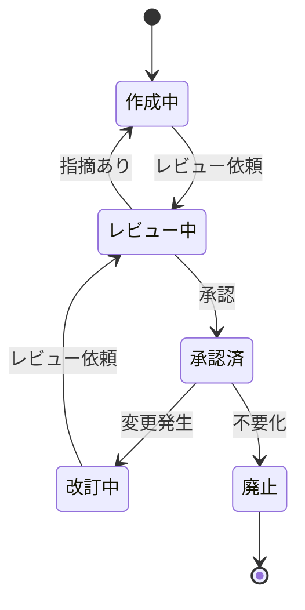

# 設計書作成規約

## 1. 目的

本書は、設計書標準に従って作成するすべての設計書に共通するルールを定義する。

各設計書固有の記載内容は「設計書作成ガイド」で定義し、本書では設計書の種類を問わず守るべき事項のみを扱う。本書の内容がガイド・テンプレートと矛盾する場合は、本書を正とする。

## 2. 規約の一覧

| 分類 | 章 | 概要 |
|------|----|------|
| ファイル形式 | 3章 | Markdown（UTF-8）で作成する |
| ディレクトリ構成 | 4章 | 工程別のディレクトリに配置する |
| ファイル命名 | 5章 | `設計書名_要素ID.md` の形式とする |
| ID体系 | 6章 | `プレフィックス-連番` の形式とし、再利用しない |
| 文書構成 | 7章 | メタ情報、必須章、変更履歴を持つ |
| 記載方法 | 8章 | 1項目1情報、結論先行、表・図を優先する |
| 表記 | 9章 | 文体・用語・数値・日付の表記を統一する |
| 図の表現 | 10章 | Mermaid を基本とする |
| 参照・リンク | 11章 | 他設計書の情報は ID とリンクで参照する |
| 未確定事項 | 12章 | `TBD` と明記し、課題として管理する |
| 変更管理 | 13章 | Git で管理し、バージョンと状態を記録する |
| レビュー | 14章 | 状態遷移とレビュー観点を統一する |

## 3. ファイル形式

| 項目 | ルール |
|------|--------|
| 形式 | Markdown（CommonMark ＋ GitHub Flavored Markdown の表記を基本とする） |
| 文字コード | UTF-8（BOM なし） |
| 改行コード | LF |
| 拡張子 | `.md` |
| 画像 | Mermaid で表現できないもの（画面レイアウトのモックアップ等）に限り使用する。`assets/` ディレクトリに PNG または SVG で配置する |
| 機械可読定義 | OpenAPI、DDL、JSON Schema 等で定義できるものは、その定義ファイルを正としてもよい。その場合、設計書には定義ファイルへの参照と補足事項のみを記載する |

## 4. ディレクトリ構成

### 4.1 設計書標準のディレクトリ構成

```text
design-standards/
├── 00_標準定義/          # 方針書・体系定義書・作成規約
├── 01_作成ガイド/        # 設計書ごとの作成ガイド
├── 02_テンプレート/      # 工程別のテンプレート
│   ├── 共通/
│   ├── 要件定義/
│   ├── 基本設計/
│   ├── 詳細設計/
│   ├── テスト/
│   └── 運用/
├── 03_記載例/            # テンプレートの記入例
└── README.md
```

### 4.2 プロジェクトでの設計書の配置

プロジェクトでは、設計書をソースコードと同じリポジトリの `docs/design/` 配下に配置することを推奨する。ソースコードと同時に変更・レビューでき、実装との乖離を防げるためである。

```text
docs/design/
├── 00_共通/
│   ├── プロジェクト概要書.md
│   ├── 設計書適用台帳.md
│   └── 用語集.md
├── 01_要件定義/
│   ├── 要件定義書.md
│   ├── 機能一覧.md
│   └── ...
├── 02_基本設計/
│   ├── システム構成設計書.md
│   ├── 画面設計/
│   │   ├── 画面一覧.md
│   │   ├── 画面設計書_SCR-001.md
│   │   └── 画面設計書_SCR-002.md
│   ├── API設計/
│   └── DB設計/
├── 03_詳細設計/
├── 04_テスト/
├── 05_運用/
└── assets/               # 画像ファイル
```

要素ごとにファイルを分ける設計書（画面・API・テーブルなど）は、設計書の種類ごとのサブディレクトリにまとめる。

## 5. ファイル命名規則

### 5.1 基本形式

| 種類 | 形式 | 例 |
|------|------|-----|
| プロジェクトで1ファイルの設計書 | `設計書名.md` | `要件定義書.md`、`機能一覧.md` |
| 要素ごとに1ファイルの設計書 | `設計書名_要素ID.md` | `画面設計書_SCR-001.md`、`API設計書_API-012.md` |
| 一覧ファイル | `要素名一覧.md` | `画面一覧.md`、`テーブル一覧.md` |
| 分割した設計書 | `設計書名_分割単位.md` | `要件定義書_会員管理.md` |
| テンプレート | `設計書名_テンプレート.md` | `画面設計書_テンプレート.md` |
| 作成ガイド | `設計書名作成ガイド.md` | `画面設計書作成ガイド.md` |
| 記載例 | `設計書名_サンプル.md` | `画面設計書_サンプル.md` |
| 画像 | `要素ID_内容.拡張子` | `SCR-001_レイアウト.png` |

### 5.2 命名の注意事項

- ファイル名に要素名（例：ログイン画面）は含めない。名称変更時にファイル名の変更が不要になり、リンク切れを防げるため。
- ファイル名に空白、`/ \ : * ? " < > |` などの記号を使わない。区切りは `_`（アンダースコア）、ID 内の区切りは `-`（ハイフン）とする。
- ファイル名に版数や日付を含めない。版数は Git とメタ情報で管理する。
- 英数字は半角とする。

## 6. ID体系

### 6.1 ID の形式

```text
プレフィックス-連番
例：SCR-001、API-012、TBL-105
```

| 項目 | ルール |
|------|--------|
| プレフィックス | 英大文字 2〜4 文字（6.2 の一覧から選ぶ） |
| 区切り | `-`（半角ハイフン） |
| 連番 | 3桁のゼロ埋め数字。999 を超える見込みがある場合は、プロジェクト開始時に4桁と定める |
| 一意性 | 同じプレフィックスの中でプロジェクト全体で一意とする |
| 再利用 | 削除・廃止した ID は再利用しない（欠番とする） |
| 不変性 | 一度採番した ID は、名称や内容が変わっても変更しない |
| 採番場所 | 各プレフィックスの「正」となる設計書（6.2 参照）で採番する |

### 6.2 プレフィックス一覧

| プレフィックス | 対象 | 採番する設計書 |
|----------------|------|----------------|
| DOC | 設計書の種類 | 設計書体系定義書（標準） |
| STD | 標準定義ドキュメント | 設計書標準 |
| REQ | 要件 | DOC-101 要件定義書 |
| NFR | 非機能要件 | DOC-104 非機能要件定義書 |
| BIZ | 業務プロセス | DOC-102 業務フロー図 |
| FNC | 機能 | DOC-103 機能一覧 |
| ENT | エンティティ（概念データ） | DOC-105 データ要件定義書 |
| SYS | システム構成要素 | DOC-201 システム構成設計書 |
| ENV | 環境 | DOC-201 システム構成設計書 |
| SCR | 画面 | DOC-202 画面設計書 |
| API | API | DOC-203 API設計書 |
| TBL | テーブル | DOC-204 DB設計書 |
| IF | 外部インターフェース | DOC-205 外部インターフェース設計書 |
| RPT | 帳票・出力ファイル | DOC-206 帳票設計書 |
| SEC | セキュリティ対策 | DOC-207 セキュリティ設計書 |
| ROL | ロール | DOC-207 セキュリティ設計書 |
| MSG | メッセージ | DOC-208 メッセージ定義書 |
| PRC | オンライン処理 | DOC-301 処理設計書 |
| BAT | バッチ処理 | DOC-301 処理設計書 |
| MOD | モジュール | DOC-302 モジュール構成設計書 |
| TST | テストケース | DOC-402 テスト仕様書 |
| OPS | 運用作業 | DOC-501 運用設計書 |
| ISS | 未確定事項・課題 | 各設計書（12章参照） |

新しいプレフィックスを追加する場合は、既存と重複しないことを確認し、本表と設計書体系定義書を更新する。

### 6.3 要素内の項目の識別

画面の入力項目、API のパラメータ、テーブルのカラムなど、要素内の項目は「要素ID ＋ 項目番号」で識別する。

```text
SCR-001-01   … 画面 SCR-001 の項目 No.01
API-012-E03  … API API-012 のエラー定義 No.03
```

### 6.4 大規模プロジェクトでのサブシステム区分

サブシステムが複数ある場合は、連番の先頭桁をサブシステムに割り当てるか、サブシステム略号を挿入してよい。いずれの方式にするかはプロジェクト開始時に決め、設計書適用台帳に記録する。

```text
方式A（番号帯）：SCR-1xx = 会員管理、SCR-2xx = 受注管理
方式B（略号）  ：SCR-MBR-001、SCR-ORD-001
```

## 7. 文書構成

### 7.1 メタ情報

すべての設計書の先頭に、次のメタ情報を YAML Front Matter で記載する。

```yaml
---
doc_id: DOC-202            # 設計書の種類（設計書体系定義書のID）
element_id: SCR-001        # 要素ID（要素ごとのファイルの場合）
title: 画面設計書 ログイン画面
version: 1.0.0
status: 承認済             # 14.1 の状態のいずれか
created: 2026-11-23
updated: 2026-11-23
author: 作成者名
reviewer: レビュー者名
---
```

### 7.2 必須章

すべての設計書は、次の章を必ず持つ。設計書固有の章は「仕様」の位置に配置する。

| 順序 | 章 | 記載内容 |
|------|----|----------|
| 1 | 目的 | この設計書（要素）が何のために存在するか |
| 2 | 対象範囲 | 対象とするもの・対象外とするもの |
| 3 | 前提・制約 | 設計の前提条件、制約条件（ない場合は「なし」と記載） |
| 4 | 仕様 | 設計書固有の内容（テンプレートで定義） |
| 5 | 関連資料 | 上流・関連する設計書と要素ID |
| 6 | 未確定事項 | TBD の一覧（ない場合は「なし」と記載） |
| 7 | 変更履歴 | 版数・日付・変更内容・変更者 |

### 7.3 章の扱い

- 該当する内容がない章も削除せず、「なし」または「対象外」と記載する。削除すると「検討漏れ」と「該当なし」の区別がつかなくなるため。
- テンプレートの章番号・章名は変更しない。プロジェクト固有の章を追加する場合は、該当する章の末尾に追加する。

## 8. 記載方法

### 8.1 基本原則

| 原則 | 内容 | 悪い例 | 良い例 |
|------|------|--------|--------|
| 1項目1情報 | 1つの欄・1つの文には1つの情報だけを書く | 「必須。半角英数字で20文字以内、未入力時はエラー」を1欄に記載 | 必須／文字種／桁数／エラー時の動作を別の欄に分ける |
| 結論先行 | 結論・概要を先に、理由・詳細を後に書く | 経緯から書き始める | 「〜とする。理由は〜」 |
| 表・図の優先 | 条件分岐・一覧・関係は文章ではなく表・図で表す | 「Aの場合はX、Bの場合はY、…」 | 条件と結果の表（デシジョンテーブル） |
| 曖昧語の排除 | 解釈が分かれる語を使わない | 「適切に」「なるべく」「など」「速やかに」 | 具体的な条件・数値・列挙で書く |
| 主語の明示 | 誰（何）が行うかを明確にする | 「データを登録する」 | 「システムは注文データを登録する」 |
| 判定可能性 | テストで確認できる書き方にする | 「使いやすい画面とする」 | 「主要操作を3クリック以内で完了できる」 |
| 単一情報源 | 他の設計書が正となる情報は転記せず参照する（11章） | テーブル定義を API 設計書に転記 | 「TBL-003 参照」とリンクする |

### 8.2 「など」「等」の扱い

列挙は原則としてすべて書き切る。書き切れない場合は「など」を使わず、「以下を含む（網羅は 〇〇 を参照）」のように網羅している場所を示す。

### 8.3 要件・仕様の強さの表現

| 表現 | 意味 |
|------|------|
| 〜とする／〜しなければならない | 必須。守らない場合は不適合 |
| 〜することが望ましい | 推奨。守らない場合は理由を記録する |
| 〜してもよい | 許容。任意 |
| 〜してはならない | 禁止 |

## 9. 表記

| 項目 | ルール | 例 |
|------|--------|-----|
| 文体 | 本文は常体（である調）。手順書・利用者向け文書は敬体（です・ます調）でもよい | 「〜とする。」 |
| 句読点 | 「、」「。」を使用する | |
| 英数字 | 半角 | `ID`、`100` |
| カタカナ | 全角。長音は原則として付ける | ユーザー、サーバー、データ |
| 括弧 | 日本語文中は全角（）、コード・ID は半角 | （任意）、`func()` |
| 日付 | `YYYY-MM-DD` | 2026-11-23 |
| 日時 | `YYYY-MM-DD HH:MM:SS`、タイムゾーンが必要な場合は明記 | 2026-11-23 10:00:00 JST |
| 数値 | 3桁区切りのカンマを付ける。単位を必ず付ける | 1,000件、500ms |
| 用語 | 用語集（DOC-003）に定義した表記を使う。同義語・禁止表記は使わない | |
| コード・識別子 | バッククォートで囲む | `user_id` |
| 強調 | 太字を使う。多用しない | **必須** |

## 10. 図の表現

### 10.1 基本方針

図は Mermaid を基本とする。テキストで管理でき、Git で差分を確認でき、特定のツールに依存しないためである。

| 図の種類 | Mermaid の記法 | 主な用途 |
|----------|----------------|----------|
| フローチャート | `flowchart` | 業務フロー、処理フロー、判断フロー |
| シーケンス図 | `sequenceDiagram` | 画面・API・外部システム間のやり取り |
| 状態遷移図 | `stateDiagram-v2` | データや画面の状態遷移 |
| ER図 | `erDiagram` | エンティティ・テーブルの関係 |
| クラス図 | `classDiagram` | モジュール構成、ドメインモデル |
| ガントチャート | `gantt` | スケジュール（必要な場合） |
| 構成図 | `flowchart`（subgraph を使用） | システム構成、ネットワーク構成 |

### 10.2 図のルール

- 図には必ずタイトル（直前の見出しまたはキャプション）を付ける。
- 1つの図に要素を詰め込みすぎない。目安としてノード数が20を超える場合は分割する。
- ノードには ID と名称を併記する（例：`SCR-001<br/>ログイン画面`）。
- 図と本文・表で同じ情報を書く場合は、表を正とし、図は理解の補助と位置付ける。
- Mermaid で表現できない図（画面モックアップ、複雑なネットワーク図など）は画像としてよい。その場合、元データ（作成ツールのファイル）も `assets/` に保存する。

## 11. 参照・リンク

### 11.1 参照の書き方

他の設計書の情報を使う場合は、内容を転記せず、ID と相対リンクで参照する。

```markdown
入力値の形式は [TBL-003 会員テーブル](../DB設計/DB設計書_TBL-003.md) の `email` カラム定義に従う。
```

| 項目 | ルール |
|------|--------|
| リンク形式 | 相対パスで記載する（絶対 URL は外部資料のみ） |
| 表示文字列 | `要素ID 要素名` とする |
| 設計書内の章参照 | `（本書 4.2 参照）` のように記載する |
| 外部資料 | 資料名、版数、URL または保管場所を記載する |

### 11.2 上流 ID の記載

下流の設計書は、根拠となる上流の要素 ID を「関連資料」章または各要素の「対応要件」欄に必ず記載する（設計書体系定義書 8章参照）。

## 12. 未確定事項

### 12.1 TBD の記載

設計時点で決まっていない事項は、推測で埋めずに `TBD` と明記する。

```markdown
| セッション有効期限 | TBD（ISS-003） |
```

| ルール | 内容 |
|--------|------|
| 表記 | `TBD` と半角大文字で記載する。空欄や「未定」「検討中」は使わない |
| 課題ID | `TBD` には必ず課題ID（`ISS-xxx`）を併記する |
| 一覧化 | 各設計書の「未確定事項」章に一覧を記載する |
| 解消 | 決定したら値を記入し、未確定事項の一覧で「解決済」とし、決定日と決定内容を記録する |
| 状態との関係 | `TBD` が残っている設計書は「承認済」にしない。ただし、影響範囲と期限を明記して合意した場合はこの限りではない |

### 12.2 未確定事項の一覧形式

| 課題ID | 内容 | 影響範囲 | 担当 | 期限 | 状態 | 決定内容 |
|--------|------|----------|------|------|------|----------|
| ISS-003 | セッション有効期限の決定 | SCR-001、SEC-002 | — | 2026-12-10 | 未解決 | — |

### 12.3 関連する記号

| 記号 | 意味 | 使い方 |
|------|------|--------|
| TBD | To Be Determined：未決定 | 値・仕様が決まっていない |
| TBC | To Be Confirmed：要確認 | 仮の値は記載済みだが確認が必要 |
| N/A | Not Applicable：該当なし | その項目が対象外であることを明示する |

## 13. 変更管理

### 13.1 バージョン管理

| 項目 | ルール |
|------|--------|
| 管理ツール | Git |
| 管理単位 | 設計書ファイル単位 |
| ブランチ | ソースコードと同じブランチ戦略に従う。設計変更は実装変更と同じブランチ・同じプルリクエストで行うことを推奨する |
| コミットメッセージ | 変更した要素 ID を含める（例：`SCR-001: パスワード入力欄の桁数を変更`） |

### 13.2 設計書の版数

設計書の版数は `メジャー.マイナー.パッチ` の形式とする。

| 区分 | 上げる条件 | 例 |
|------|------------|-----|
| メジャー | 承認済の設計書に、仕様の意味が変わる変更を加えたとき | 項目の追加・削除、振る舞いの変更 |
| マイナー | 仕様の意味は変えずに内容を追加・補足したとき | 説明の追加、TBD の解消 |
| パッチ | 誤字脱字、表現の修正 | |

初版作成中は `0.x.x` とし、初回承認時に `1.0.0` とする。

### 13.3 変更履歴

各設計書の末尾に、次の形式で変更履歴を記載する。Git の履歴と重複するが、設計書単体で読んだときに変更の経緯が分かるようにするため、主要な変更（マイナー以上）は記載する。

| バージョン | 日付 | 変更内容 | 変更者 |
|------------|------|----------|--------|
| 1.1.0 | 2026-12-01 | エラー処理にアカウントロックを追加（ISS-005 解決） | — |
| 1.0.0 | 2026-11-23 | 初版承認 | — |

## 14. 状態とレビュー

### 14.1 設計書の状態



| 状態 | 意味 |
|------|------|
| 作成中 | 初版を作成している |
| レビュー中 | レビューを受けている |
| 承認済 | レビューが完了し、内容が確定している |
| 改訂中 | 承認済の設計書を変更している |
| 廃止 | 使用しなくなった。削除せずに残し、代替先を記載する |

個人開発でレビュー者がいない場合は、作成者がセルフレビュー（14.2 のチェックリストを使用）を行い、承認済としてよい。

### 14.2 共通レビュー観点

すべての設計書のレビューで、次の観点を確認する。設計書固有の観点は各作成ガイドで定義する。

| No | 観点 | 確認内容 |
|----|------|----------|
| 1 | 必須章 | 7.2 の必須章がすべて存在するか |
| 2 | メタ情報 | 7.1 のメタ情報が正しく記載されているか |
| 3 | ID | ID が 6章の規則に従い、重複していないか |
| 4 | 追跡可能性 | 上流の要素 ID が記載されているか |
| 5 | 単一情報源 | 他の設計書が正となる情報を転記していないか |
| 6 | 責務 | 設計書体系定義書の「定義しないこと」を書いていないか |
| 7 | 曖昧さ | 曖昧語がなく、テストで判定できる書き方になっているか |
| 8 | 未確定事項 | TBD に課題 ID が付き、一覧化されているか |
| 9 | 用語 | 用語集の表記に従っているか |
| 10 | 図 | 図にタイトルがあり、表と矛盾していないか |
| 11 | リンク | リンク切れがないか |

## 15. 関連資料

| ID | 資料名 | 関係 |
|----|--------|------|
| STD-001 | 設計書標準化方針書 | 本規約の上位方針 |
| STD-002 | 設計書体系定義書 | 設計書の種類（DOC-xxx）と管理要素の対応を定義する |

## 16. 変更履歴

| バージョン | 日付 | 変更内容 | 変更者 |
|------------|------|----------|--------|
| 0.1.0 | 2026-11-23 | 初版作成（ドラフト） | — |
