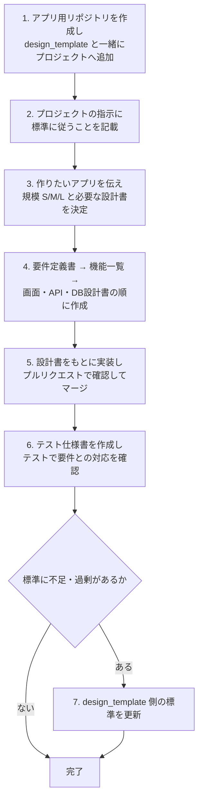

# 標準を使った開発フロー

## 1. 目的

本書は、この設計書標準（design_template リポジトリ）を使って、実際にアプリを開発する流れを定義する。Claude のプロジェクト機能と GitHub を使い、設計書の作成から実装・テスト・標準の改善までを一つの流れで進めることを想定する。

テンプレートは参考にする出発点であり、アプリに合わせて形を変えて使う（STD-001 6.2）。

## 2. 全体の流れ



## 3. 各ステップ

| No | ステップ | やること | 成果物 | 参照する標準 |
|----|----------|----------|--------|--------------|
| 1 | リポジトリの準備 | アプリ用の GitHub リポジトリを作り、新しいプロジェクトに design_template と一緒に追加する | アプリ用リポジトリ | — |
| 2 | プロジェクトの指示 | プロジェクトの指示に「設計書は design_template の標準に従う」と書く | プロジェクトの指示 | 本書 |
| 3 | 規模と設計書の決定 | 作りたいアプリを伝え、規模 S/M/L を決めて必要な設計書を選ぶ | プロジェクト概要書（DOC-001）、設計書適用台帳（DOC-002） | STD-002 4章・5章 |
| 4 | 設計書の作成 | テンプレートを参考に、アプリに合わせた形で、要件定義書 → 機能一覧 → 画面・API・DB設計書の順に作成し、各段階で内容を確認する | DOC-101、DOC-103、DOC-202〜204 ほか | STD-003、STD-004、作成ガイド、テンプレート |
| 5 | 実装 | 設計書をもとに実装し、プルリクエストで確認してマージする | ソースコード | STD-003 13章 |
| 6 | テスト | テスト仕様書を作り、テストで要件との対応を確かめる | テスト仕様書（DOC-402）、トレーサビリティマトリクス（DOC-403） | STD-002 8章 |
| 7 | 標準の改善 | 不足項目があれば design_template 側の標準も更新する | design_template の更新 | STD-001 6.3・7章 |

## 4. 運用上の注意

### 4.1 プロジェクトの指示の記載例

```text
設計書は design_template リポジトリの design-standards/ を参考にする。
- テンプレートはアプリに合わせて章・項目・形式を変えてよい。
- 要素には ID を付け、上流の ID を参照する。決まっていないことは TBD と書く。
- 設計書はアプリ用リポジトリの docs/design/ に配置する。
- 設計を変更するときは、実装と同じプルリクエストで設計書も更新する。
```

### 4.2 ステップ4の進め方

- テンプレートはそのまま埋めるのではなく、アプリに必要な章・項目だけを残し、足りないものは追加する。

- 一度にすべての設計書を作らず、要件定義書 → 機能一覧 → 各設計書の順に、段階ごとに内容を確認してから次へ進む。
- 下流の設計書を作るときは、上流の要素 ID（REQ、FNC など）を必ず記載する（STD-003 11.2）。
- 決まっていない事項は推測で埋めず、`TBD` と課題 ID で記録する（STD-003 12章）。

### 4.3 ステップ5の進め方

- 設計と実装が食い違った場合は、どちらが正しいかを判断し、設計書も同じプルリクエストで更新する。
- コミットメッセージには変更した要素 ID を含める（例：`SCR-001: パスワード入力欄の桁数を変更`）。

### 4.4 ステップ7の進め方

- アプリ側で気づいた標準の不足・過剰は、まず設計書適用台帳（DOC-002）の「標準への改善要望」に記録する。
- 他のプロジェクトでも使える内容であれば、design_template の標準に反映し、バージョンを上げる（STD-001 6.3）。
- アプリ固有の内容は標準には入れず、アプリ側のテイラリングとして扱う。

## 5. 関連資料

| ID | 資料名 | 関係 |
|----|--------|------|
| STD-001 | 設計書標準化方針書 | 標準の運用・改善の方針 |
| STD-002 | 設計書体系定義書 | 規模区分と要否判断 |
| STD-003 | 設計書作成規約 | 配置、命名、ID、変更管理のルール |
| STD-004 | 設計書項目定義書 | 各設計書に記載する項目 |

## 6. 変更履歴

| バージョン | 日付 | 変更内容 | 変更者 |
|------------|------|----------|--------|
| 0.2.0 | 2026-11-23 | テンプレートをアプリに合わせて変えて使う前提を明記 | — |
| 0.1.0 | 2026-11-23 | 初版作成（ドラフト） | — |
