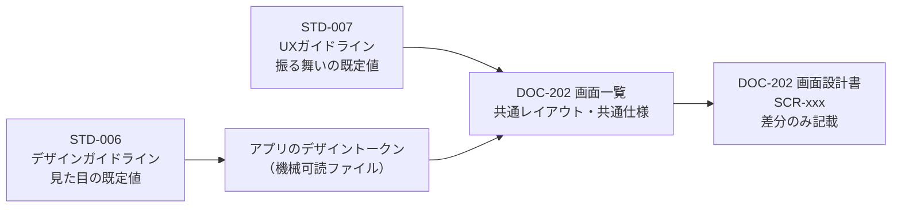

# デザインガイドライン

## 1. 目的

本書は、UI を持つアプリの**見た目のルール**（色、文字、余白、レイアウト、コンポーネントの外観、アイコン、動き）を、特定の言語・フレームワーク・UI ライブラリに依存しない形で定義する。

アプリごとに配色やフォントを一から決めずに済むようにし、画面設計書（DOC-202）では「本書に従う」と書いて差分だけを記載できるようにすることが狙いである。

本書のルールは標準の既定値である。アプリに合わせて値を変えてよい（STD-001 6.2）。ただし、アクセシビリティに関する基準（本書 11章）は下げないことを推奨する。

## 2. 対象範囲

| 区分 | 内容 |
|------|------|
| 対象 | Web アプリ、スマートフォンアプリ、デスクトップアプリの画面の見た目 |
| 対象外 | ロゴ・ブランドアイデンティティの制作、広告・LP のアートディレクション、帳票のレイアウト（→ DOC-206） |

使い勝手・操作の流れ・文言など**振る舞いのルール**は UX ガイドライン（STD-007）で定義する。本書と STD-007 の役割分担は次のとおり。

| 観点 | 本書（STD-006） | STD-007 UXガイドライン |
|------|-----------------|------------------------|
| 問い | どう見えるか | どう使えるか・どう振る舞うか |
| 例：ボタン | 種類ごとの色・サイズ・角丸・状態ごとの外観 | どの操作に主ボタンを使うか、ラベルの付け方、押した後の振る舞い |
| 例：エラー | エラー色、アイコン、表示位置の外観 | いつ検証するか、何を伝えるか、入力をどう扱うか |
| 例：アクセシビリティ | コントラスト、フォーカスの見た目、文字サイズ、タップ領域 | キーボード操作、読み上げ、時間制限、操作の取り消し |

## 3. 前提・制約

- アクセシビリティの基準は WCAG 2.2 レベル AA とする。
- 値は「デザイントークン」（本書 4章）として名前を付けて管理し、画面設計書・実装ではトークン名で参照する。
- 既存の UI ライブラリ・デザインシステム（社内標準、OS 標準のガイドライン）を採用するアプリでは、そちらを正とし、本書は不足部分の補完に使う。

## 4. デザイントークン

### 4.1 考え方

色・文字サイズ・余白などの値には名前（トークン）を付け、値を直接書かずにトークン名で参照する。値を変えるときにトークンの定義だけを直せば済み、画面ごとのばらつきを防げるためである。

トークンは次の3層で定義する。

| 層 | 役割 | 例 | 画面・実装から参照するか |
|----|------|-----|--------------------------|
| 基本トークン | 色や寸法の値そのもの | `blue-600 = #2563EB`、`space-4 = 16px` | 参照しない |
| 意味トークン | 用途を表す名前。基本トークンを指す | `color-primary = blue-600`、`color-text-danger = red-700` | 参照する（基本） |
| 部品トークン | 特定のコンポーネント専用の値（任意） | `button-height-md = 40px` | 部品の定義でのみ参照する |

### 4.2 命名規則

```text
{分類}-{用途}-{種類}-{状態}
例：color-bg-surface、color-text-secondary、color-border-focus、space-4、font-size-lg
```

| ルール | 内容 |
|--------|------|
| 文字 | 英小文字・数字・ハイフンのみ |
| 意味で名付ける | 意味トークンは色名ではなく用途で名付ける（`color-red` ではなく `color-danger`） |
| 段階の表し方 | サイズは `xs / sm / md / lg / xl / 2xl`、余白は数値の段階（`space-1` = 4px 単位）で表す |

### 4.3 管理場所

アプリでは、トークンを機械可読なファイル（JSON、CSS カスタムプロパティ、各プラットフォームのテーマ定義）で定義し、それを正としてよい（STD-003 3章「機械可読定義」）。設計書にはファイルの場所と、本書の既定値から変えた点だけを書く（本書 13章）。

## 5. 色

### 5.1 意味トークン（既定値）

色は用途（役割）で定義する。下表の値はライトテーマの既定値である。

| トークン | 用途 | 既定値 |
|----------|------|--------|
| `color-bg-base` | 画面全体の背景 | `#FFFFFF` |
| `color-bg-subtle` | 区切られた領域・表の見出し行の背景 | `#F5F6F8` |
| `color-bg-surface` | カード・モーダルの背景 | `#FFFFFF` |
| `color-text-primary` | 本文・見出し | `#1F2329` |
| `color-text-secondary` | 補足・ラベル・プレースホルダー以外の弱い文字 | `#5A6270` |
| `color-text-disabled` | 無効状態の文字 | `#9AA1AC` |
| `color-text-on-primary` | 主色の上に載せる文字 | `#FFFFFF` |
| `color-border-default` | 入力欄・選択部品の枠線（3:1 を満たす） | `#858C97` |
| `color-border-subtle` | 区切り線・カードの枠線（装飾目的に限る） | `#E3E6EA` |
| `color-border-focus` | フォーカスリング | `#2563EB` |
| `color-primary` | 主ボタン・リンク・選択状態 | `#2563EB` |
| `color-primary-hover` | 主色のホバー時 | `#1D4ED8` |
| `color-success` | 成功・完了 | `#15803D` |
| `color-warning` | 注意（文字・アイコンに使う場合） | `#A16207` |
| `color-danger` | エラー・削除などの破壊的操作 | `#B91C1C` |
| `color-info` | お知らせ・ヒント | `#0369A1` |
| `color-overlay` | モーダル背後の覆い | `rgba(15, 23, 42, 0.5)` |

状態色（success / warning / danger / info）には、背景用の薄い色（例：`color-danger-bg = #FEF2F2`）を対で定義する。

### 5.2 配色のルール

| No | ルール |
|----|--------|
| 1 | 主色（`color-primary`）は1色とする。1画面の中で主色を使う主ボタンは原則1つとする |
| 2 | 状態色は意味を固定し、装飾に使ってはならない（赤は危険・エラー以外に使わない） |
| 3 | 色だけで情報を伝えてはならない。アイコン・文字・形を併用する（例：エラーは赤枠＋アイコン＋メッセージ） |
| 4 | 画面で使う色は意味トークンに限る。トークンにない色が必要になった場合は、トークンを追加してから使う |
| 5 | 背景・面・文字の3段階で奥行きを表す。グラデーションや多色の装飾は使わないことが望ましい |

### 5.3 コントラスト

| 対象 | 最低コントラスト比（背景に対して） |
|------|------------------------------------|
| 本文（18.66px 未満の太字、24px 未満の通常文字） | 4.5 : 1 |
| 大きな文字（24px 以上、または 18.66px 以上の太字） | 3 : 1 |
| 入力欄の枠線、アイコン、フォーカスリングなど意味を持つ UI 部品 | 3 : 1 |
| 無効状態の部品 | 基準なし（ただし無効であることが文字で分かるようにする） |

### 5.4 ダークテーマ

ダークテーマを用意する場合は、意味トークンの値だけを差し替え、トークン名は変えない。

| ルール | 内容 |
|--------|------|
| 背景 | 純黒（`#000000`）を避け、`#121417` 程度の暗い灰色とする |
| 奥行き | 手前の面ほど明るくする（影ではなく明度で区別する） |
| 主色・状態色 | 彩度・明度を調整し、5.3 のコントラストを満たす値に置き換える |
| 切り替え | OS の設定に従うことを既定とし、手動切り替えは任意とする |

## 6. タイポグラフィ

### 6.1 フォント

| 用途 | 既定値 |
|------|--------|
| 本文・見出し | OS 標準のフォント（`system-ui, -apple-system, "Segoe UI", "Hiragino Sans", "Noto Sans JP", "Yu Gothic UI", sans-serif`） |
| 等幅（コード・ID・数値の桁揃え） | `ui-monospace, "SFMono-Regular", Menlo, Consolas, monospace` |

Web フォントを使う場合は、日本語フォントの容量が大きいことを考慮し、表示速度の要件（NFR）を満たすことを確認する。

### 6.2 文字サイズの段階

| トークン | サイズ | 行の高さ | 主な用途 |
|----------|--------|----------|----------|
| `font-size-xs` | 12px | 1.5 | 注記、バッジ（本文には使わない） |
| `font-size-sm` | 14px | 1.6 | 補足、表、入力欄のヘルプ |
| `font-size-md` | 16px | 1.7 | 本文、入力値、ボタン（既定） |
| `font-size-lg` | 18px | 1.6 | 小見出し |
| `font-size-xl` | 20px | 1.5 | セクション見出し |
| `font-size-2xl` | 24px | 1.4 | 画面タイトル |
| `font-size-3xl` | 32px | 1.3 | ダッシュボードの数値、LP の見出し |

| No | ルール |
|----|--------|
| 1 | 本文は 16px を既定とし、14px 未満にしてはならない。入力欄の文字は 16px 未満にしてはならない（iOS の Safari は 16px 未満の入力欄にフォーカスすると画面を拡大するため）。拡大を防ぐ目的で、利用者の拡大操作を禁止する指定（`user-scalable=no` など）を使ってはならない |
| 2 | 1画面で使う文字サイズは4段階以内とすることが望ましい |
| 3 | 日本語の本文の行の高さは 1.6〜1.8 とする（英字中心の UI より広めにとる） |
| 4 | 1行の長さは全角 35〜45 文字を目安とし、本文領域に最大幅を設ける |
| 5 | 文字の大きさはユーザーの設定（ブラウザの文字サイズ、OS の文字サイズ）に追従させる。Web では `rem` 単位を使う |

### 6.3 太さ

| トークン | 値 | 用途 |
|----------|-----|------|
| `font-weight-regular` | 400 | 本文 |
| `font-weight-bold` | 700 | 見出し、強調、主ボタン |

中間の太さ（500、600）は、フォントが対応している場合に限り見出しに使ってよい。強調は太字のみとし、斜体・下線（リンク以外）は使わない。

### 6.4 数値・日付の表示

表記は設計書作成規約（STD-003）9章に合わせる。表の数値は右揃えとし、桁がそろうように等幅数字（`font-variant-numeric: tabular-nums` 相当）を使う。

## 7. 余白とレイアウト

### 7.1 余白の段階

余白は 4px を基本単位とし、次の段階から選ぶ。段階にない値は使わない。

| トークン | 値 | 主な用途 |
|----------|-----|----------|
| `space-1` | 4px | アイコンと文字の間 |
| `space-2` | 8px | 関連の強い要素の間（ラベルと入力欄） |
| `space-3` | 12px | ボタン内の左右余白（小） |
| `space-4` | 16px | 入力項目どうしの間、カードの内側余白、スマートフォンの画面端 |
| `space-6` | 24px | グループどうしの間、デスクトップのカードの内側余白 |
| `space-8` | 32px | セクションどうしの間 |
| `space-12` | 48px | 画面内の大きな区切り |
| `space-16` | 64px | ページ上下の余白（広い画面） |

関連の強いものは近く、関連の弱いものは遠くに置く（近接の原則）。グループ内の余白はグループ間の余白より必ず小さくする。

### 7.2 ブレークポイント

| 名前 | 画面幅 | 想定端末 | 列数 | 画面端の余白 |
|------|--------|----------|------|--------------|
| `sm` | 〜599px | スマートフォン | 4 | 16px |
| `md` | 600〜1,023px | タブレット、小さいウィンドウ | 8 | 24px |
| `lg` | 1,024〜1,439px | ノート PC | 12 | 32px |
| `xl` | 1,440px〜 | 大きなディスプレイ | 12 | 32px（本文は最大幅で中央寄せ） |

| No | ルール |
|----|--------|
| 1 | 小さい画面から設計し、広い画面に広げる（モバイルファースト） |
| 2 | 本文領域の最大幅は 1,200px を既定とする。読み物中心の画面は 720px とする |
| 3 | 幅 320px で横スクロールが発生してはならない（表など2次元の情報を除く） |
| 4 | 列の間隔（ガター）は `sm` で 16px、それ以外で 24px とする |

### 7.3 画面の基本構成

画面は次の領域で構成することを既定とする。アプリ固有の共通レイアウトは画面一覧（DOC-202）の「共通レイアウト」に書く。

```text
+----------------------------------------------------+
| ヘッダー（アプリ名・グローバルナビ・アカウント）   |
+-----------+----------------------------------------+
| サイド     | ページヘッダー（パンくず・画面タイトル・ |
| ナビ       |               主操作）                 |
| （任意）   +----------------------------------------+
|            | 本文                                   |
|            |                                        |
+-----------+----------------------------------------+
| フッター（任意）                                    |
+----------------------------------------------------+
```

`sm` ではサイドナビを隠し、メニューボタンまたは下部タブで切り替える。

### 7.4 角丸・影・重なり順

| トークン | 値 | 用途 |
|----------|-----|------|
| `radius-sm` | 4px | バッジ、チェックボックス |
| `radius-md` | 8px | ボタン、入力欄、カード |
| `radius-lg` | 12px | モーダル、ボトムシート |
| `radius-full` | 9999px | 丸型アバター、ピル型のタグ |
| `shadow-sm` | `0 1px 2px rgba(0,0,0,0.08)` | カード（任意） |
| `shadow-md` | `0 4px 12px rgba(0,0,0,0.12)` | ドロップダウン、ポップオーバー |
| `shadow-lg` | `0 12px 32px rgba(0,0,0,0.16)` | モーダル |

重なり順（z-index）は「本文 < 固定ヘッダー < ドロップダウン < 覆い < モーダル < トースト」の順とし、値はトークン（`z-header`、`z-dropdown`、`z-overlay`、`z-modal`、`z-toast`）で管理する。

浮いて表示する部品（候補の一覧、メニュー、ポップオーバー）は、主操作のボタン（保存など）を覆ってはならない。`sm` では画面の下半分がソフトウェアキーボードで隠れる前提で、候補は入力欄の上、またはキーボードの上に見える位置に出す。新しく出す入力欄・メニューは画面の見える位置に出し、画面外に作られた場合は見える位置までスクロールする。

## 8. アイコンと画像

| No | ルール |
|----|--------|
| 1 | アイコンは1つのアイコンセットに統一する（線の太さ・角の形をそろえる） |
| 2 | サイズは 16px（文字と並べる）、20px（ボタン内）、24px（単独）を基本とする |
| 3 | アイコンだけのボタンには、見えるラベルまたは読み上げ用のラベルを必ず付ける。意味が一般的でないアイコン（ゴミ箱・検索・閉じる以外）は文字ラベルを併記することが望ましい |
| 4 | 意味を持つ画像には代替テキストを付ける。装飾だけの画像は読み上げ対象から外す |
| 5 | 画像は表示サイズに合わせた解像度（高密度画面では2倍）で用意し、表示領域の縦横比を先に確保してレイアウトのずれを防ぐ |
| 6 | 写真・イラストの上に文字を載せる場合は、5.3 のコントラストを満たすよう覆いを敷く |

## 9. コンポーネント

コンポーネントの**外観**を定義する。どの場面で使うか・押したときの振る舞いは UX ガイドライン（STD-007）に従う。

### 9.1 ボタン

| 種類 | 外観 | 用途の例 |
|------|------|----------|
| 主ボタン（Primary） | 主色で塗る。文字は `color-text-on-primary` | 保存、送信、次へ |
| 副ボタン（Secondary） | 白地＋枠線＋主色または本文色の文字 | キャンセル、戻る |
| テキストボタン（Tertiary） | 枠・背景なし。主色の文字 | 詳細を表示、さらに読み込む |
| 危険ボタン（Danger） | `color-danger` で塗る、または枠線＋危険色の文字 | 削除、解約 |

| サイズ | 高さ | 左右余白 | 文字 |
|--------|------|----------|------|
| `sm` | 32px | 12px | 14px |
| `md`（既定） | 40px | 16px | 16px |
| `lg` | 48px | 24px | 16px |

- 角丸は `radius-md` とする。ラベルは1行に収め、折り返さない。
- `sm` サイズを使う場合も、タップ・クリックできる領域は 11.2 の最小サイズを確保する。

### 9.2 状態ごとの外観

すべての操作可能な部品は、次の状態の外観を定義する。

| 状態 | 外観 |
|------|------|
| 通常 | 既定の外観 |
| ホバー | 背景または文字を1段階濃くする（`*-hover` トークン） |
| フォーカス | 2px の `color-border-focus` のリングを、部品から 2px 離して表示する。リングを消してはならない |
| 押下 | ホバーよりさらに1段階濃くする。タッチ操作では指が触れた瞬間に表示する（iOS では `:active` が既定で効かない場合があるため、タッチ開始で効くことを実機で確かめる）。押した結果で画面が変わらない部品（コピー、お気に入りなど）は、押下の外観に加えて結果の表示（STD-007 8.1）を出す |
| 選択 | 主色の背景またはチェック表示。色だけでなく形でも示す |
| 無効 | 文字を `color-text-disabled`、背景を `color-bg-subtle` にする。透明度だけで表さない |
| 処理中 | ラベルの横にスピナーを表示し、ボタンの幅を変えない |

### 9.3 入力欄

| 項目 | ルール |
|------|--------|
| 高さ・角丸 | 40px、`radius-md`（ボタンの `md` とそろえる） |
| 枠線 | 1px の `color-border-default`。フォーカス時は 9.2 のリング |
| ラベル | 入力欄の上に置く。`font-size-sm`、`font-weight-bold` |
| 必須・任意の表示 | ラベルの横に文字で「必須」または「任意」と表示する（どちらを表示するかはアプリで統一する。STD-007 参照） |
| ヘルプ文 | 入力欄の下に `font-size-sm`、`color-text-secondary` で表示する |
| エラー表示 | 枠線を `color-danger` にし、入力欄の下にアイコン＋メッセージを `color-danger` で表示する。ヘルプ文はエラー文の下に残す |
| プレースホルダー | 入力例の提示に限る。ラベルの代わりにしてはならない |
| 幅 | 入力する値の長さに合わせる（郵便番号は短く、住所は長く） |
| 文字サイズ | 入力値は 16px 以上（6.2 No.1）。表示状態をタップすると入力欄に切り替わる部品は、表示と入力で文字サイズ・行の高さ・余白をそろえ、切り替えで位置がずれないようにする |
| 複数行の欄 | 読む・書く量に合わせ、内容が数行（目安 5 行以上）見える高さを取る。1〜2行しか見えない欄にしない。長い内容は全体を広げるか、続きがあることが分かる表示にする |

### 9.4 その他の部品

| 部品 | 外観のルール |
|------|--------------|
| カード | `color-bg-surface`、`radius-md`、枠線 `color-border-subtle` または `shadow-sm` のどちらか一方 |
| 表 | 見出し行は `color-bg-subtle`。行の区切りは `color-border-subtle` の横線のみ。数値は右揃え。行の高さは 48px（詰める場合 36px） |
| モーダル | 幅は `sm` で画面幅いっぱい（下からのシート可）、それ以外は 480px／640px／800px から選ぶ。`radius-lg`、`shadow-lg`、背後に `color-overlay` |
| トースト | 画面の下中央（`sm`）または右下（`md` 以上）。状態色のアイコン＋文字。幅は最大 400px |
| バナー（画面内のお知らせ） | 本文の上に全幅で表示。状態色の薄い背景＋左端のアイコン |
| バッジ・タグ | `font-size-xs`〜`sm`、`radius-sm` または `radius-full`。状態色を使う場合は文字も併記する |
| タブ | 選択中のタブは主色の下線（2〜3px）＋太字。下線だけに頼らない |
| スケルトン（読み込み中の仮表示） | `color-bg-subtle` の面で、実際の配置と同じ形を示す |

## 10. 動き（モーション）

| トークン | 時間 | 用途 |
|----------|------|------|
| `duration-fast` | 100ms | ホバー・押下の色の変化 |
| `duration-normal` | 200ms | ドロップダウン・トーストの出入り |
| `duration-slow` | 300ms | モーダル・ドロワーの出入り |

| No | ルール |
|----|--------|
| 1 | 動きは状態の変化を伝えるために使い、装飾のためには使わない |
| 2 | 出現は減速（ease-out）、退出は加速（ease-in）とする |
| 3 | 300ms を超える動きは使わない（読み込み表示を除く） |
| 4 | OS の「視差効果を減らす／動きを減らす」設定が有効な場合は、移動・拡大の動きを止め、フェードのみにする |
| 5 | 1秒間に3回を超えて点滅させてはならない |

## 11. 見た目に関するアクセシビリティ

操作・読み上げに関するアクセシビリティは STD-007 で定義する。本章は見た目に関する基準のみを扱う。

### 11.1 基準

| No | 基準 | 本書の該当箇所 |
|----|------|----------------|
| 1 | 文字・UI 部品のコントラストを満たす | 5.3 |
| 2 | 色だけで情報を伝えない | 5.2 No.3 |
| 3 | フォーカスが常に見える | 9.2 |
| 4 | 文字を 200% に拡大しても、内容が欠けず、操作できる | 6.2 No.5、7.2 No.3 |
| 5 | 動きを減らす設定を尊重する | 10章 No.4 |

### 11.2 操作対象の大きさ

| 対象 | 最小 | 推奨 |
|------|------|------|
| タップ・クリックできる領域 | 24 × 24px | 44 × 44px（タッチ操作が主の画面） |
| 隣り合う操作対象の間隔 | 8px | — |

見た目のアイコンが小さい場合も、押せる領域を広げて基準を満たす。

## 12. 画面設計書・UXガイドラインとの関係



| 設計書 | 書くこと |
|--------|----------|
| アプリのデザイントークン | 本書の既定値から変えた値（主色、フォント）を含むトークンの定義 |
| DOC-202 画面一覧「共通レイアウト」 | 7.3 をもとにしたアプリの共通レイアウト |
| DOC-202 画面一覧「共通仕様」 | 「見た目は STD-006 に従う」と書き、本書から変えた点・追加した部品だけを書く |
| DOC-202 画面設計書（SCR-xxx） | 本書・共通仕様と異なる見た目をする場合だけ、その理由と内容を書く。色・サイズはトークン名で書く |

## 13. アプリへの適用

1. 本書の既定値をそのまま使うか、変えるかを決める。変えるのは主色・フォント・角丸の3点にとどめることが望ましい。
2. 変えた点を、画面一覧（DOC-202）の共通仕様と、トークンの定義ファイルに記録する。
3. 主色を変えた場合は、5.3 のコントラストを確認する。
4. 他のアプリでも使える変更（新しい部品、トークンの追加）は、設計書適用台帳（DOC-002）の「標準への改善要望」に記録し、本書に反映する。

## 14. レビュー観点

画面設計書・実装のレビューで、次を確認する。

| No | 観点 | 確認内容 |
|----|------|----------|
| 1 | トークン | 色・文字サイズ・余白がトークン名で指定され、直接の値が書かれていないか |
| 2 | 主ボタン | 1画面に主ボタンが原則1つか |
| 3 | 色の意味 | 状態色を装飾に使っていないか。色だけで情報を伝えていないか |
| 4 | コントラスト | 文字 4.5:1、大きな文字・UI 部品 3:1 を満たすか |
| 5 | 文字 | 本文が 14px 以上か。1画面の文字サイズが4段階以内か |
| 6 | 余白 | 余白が段階の値か。グループ内の余白がグループ間より小さいか |
| 7 | 状態 | 操作可能な部品に、ホバー・フォーカス・押下・無効・処理中の外観があるか。押下がタッチ端末の実機で表示されるか |
| 8 | フォーカス | フォーカスリングが消されていないか |
| 9 | レスポンシブ | 幅 320px で横スクロールが出ないか。文字 200% で欠けないか |
| 10 | 操作対象 | 押せる領域が 24 × 24px 以上か |
| 11 | 動き | 300ms 以内か。動きを減らす設定で止まるか |
| 12 | 入力欄の拡大 | 入力欄の文字が 16px 以上で、iPhone でタップしても画面が拡大しないか |
| 13 | 浮く部品 | 候補・メニューが主操作のボタンを覆わないか。キーボードを開いた状態で見えるか |
| 14 | 表示の広さ | 複数行の欄が数行見える高さか。データが多いときも新しい入力欄が見える位置に出るか |

## 15. 関連資料

| ID | 資料名 | 関係 |
|----|--------|------|
| STD-001 | [設計書標準化方針書](01_設計書標準化方針書.md) | 標準をアプリに合わせて変える考え方（6.2） |
| STD-003 | [設計書作成規約](03_設計書作成規約.md) | 表記（9章）、機械可読定義（3章） |
| STD-007 | [UXガイドライン](07_UXガイドライン.md) | 振る舞い・文言・操作のアクセシビリティ |
| DOC-202 | [画面設計書作成ガイド](../01_作成ガイド/画面設計書作成ガイド.md) | 本書を参照する設計書 |
| — | WCAG 2.2（W3C 勧告） | アクセシビリティ基準の出典 |

## 16. 未確定事項

なし

## 17. 変更履歴

| バージョン | 日付 | 変更内容 | 変更者 |
|------------|------|----------|--------|
| 0.1.0 | 2026-11-25 | 初版作成（ドラフト） | — |
| 0.2.0 | 2026-11-25 | 試作アプリの改善を反映（入力欄の拡大防止、押下の外観、浮く部品の位置、複数行の欄の高さ） | — |
