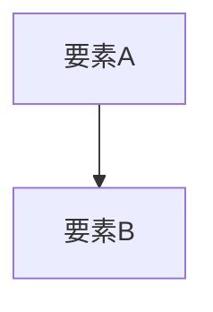

# プロジェクト概要書

<!-- テンプレート：DOC-001 プロジェクト概要書／責務：このプロジェクトは、なぜ、何を、どこまでやるのか。／書き方は 01_作成ガイド/プロジェクト概要書作成ガイド.md を参照 -->

## 1. 目的

（記載する）

## 2. 対象範囲

| 区分 | 内容 |
|----|----|
| 対象 |  |
| 対象外 |  |

## 3. 前提・制約

- なし

## 4. 仕様

### 4.1 背景

<!-- プロジェクトに至った経緯、現状の課題 -->

（記載する）

### 4.2 目的・ゴール

<!-- 達成したいこと -->

（記載する）

### 4.3 成功基準

<!-- ゴール達成を判断する指標と目標値 -->

| 指標 | 目標値 | 測定方法 |
|----|------|--------|
|  |  |  |

### 4.4 スコープ

<!-- 対象・対象外（業務、システム、組織） -->

| 区分 | 対象 | 対象外 |
|----|----|------|
| 業務 |  |  |
| システム |  |  |
| 組織・利用者 |  |  |

### 4.5 ステークホルダー

<!-- 関係者、役割、関心事 -->

| 関係者 | 役割 | 関心事 |
|------|----|------|
|  |  |  |

### 4.6 システム概要

<!-- システムの位置付けを示す概要図（コンテキスト図） -->

### 4.7 前提条件

<!-- プロジェクト全体の前提 -->

- 

### 4.8 制約条件

<!-- 予算、期間、技術、法令などの制約 -->

| 種別 | 内容 |
|----|----|
| 予算 |  |
| 期間 |  |
| 技術 |  |
| 法令・規格 |  |

### 4.9 体制

<!-- 役割と担当（個人開発は省略可）（任意） -->

| 役割 | 担当 | 責任範囲 |
|----|----|--------|
|  |  |  |

### 4.10 マイルストーン

<!-- 主要な節目のみ（詳細スケジュールはプロジェクト管理文書）（任意） -->

| マイルストーン | 予定日 | 完了条件 |
|--------------|------|--------|
|  |  |  |

## 5. 関連資料

| ID | 資料名 | 関係 |
|----|------|----|
|  |  |  |

## 6. 未確定事項

| 課題ID | 内容 | 影響範囲 | 担当 | 期限 | 状態 | 決定内容 |
|--------|----|--------|----|----|----|--------|
|  |  |  |  |  |  |  |

## 7. 変更履歴

| バージョン | 日付 | 変更内容 | 変更者 |
|----------|----|--------|------|
| 0.1.0 | YYYY-MM-DD | 初版作成 |  |
