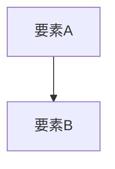

# システム構成設計書

<!-- テンプレート：DOC-201 システム構成設計書／責務：システムは、何で構成され、どのような共通方式で動くか。／書き方は 01_作成ガイド/システム構成設計書作成ガイド.md を参照 -->

## 1. 目的

（記載する）

## 2. 対象範囲

| 区分 | 内容 |
|----|----|
| 対象 |  |
| 対象外 |  |

## 3. 前提・制約

- なし

## 4. 仕様

### 4.1 全体構成図

<!-- 論理構成（構成要素と関係） -->

### 4.2 構成要素一覧

<!-- 構成要素ID（SYS）、名称、役割、対応する NFR -->

| 構成要素ID | 名称 | 役割 | 対応NFR ID |
|------------|----|----|----------------|
|  |  |  |  |

### 4.3 物理・インフラ構成

<!-- サーバー、クラウドサービス、ネットワーク構成 -->

| 構成要素ID | サービス・製品 | スペック | 備考 |
|------------|--------------|--------|----|
|  |  |  |  |

### 4.4 採用技術

<!-- 言語、フレームワーク、ミドルウェア、選定理由、バージョン方針 -->

| 分類 | 技術 | バージョン | 選定理由 |
|----|----|----------|--------|
| 言語 |  |  |  |
| フレームワーク |  |  |  |
| データベース |  |  |  |
| 実行基盤 |  |  |  |
| その他 |  |  |  |

### 4.5 環境一覧

<!-- 環境ID（ENV）、用途（開発・検証・本番）、差異 -->

| 環境ID | 環境名 | 用途 | 本番との差異 |
|--------|------|----|------------|
|  |  |  |  |

### 4.6 共通方式

<!-- ログ出力、例外処理、トランザクション、日時・タイムゾーン、文字コード、採番、キャッシュ、ファイル保管の方針 -->

| 方式 | 方針 |
|----|----|
| ログ出力 |  |
| 例外処理 |  |
| トランザクション |  |
| 日時・タイムゾーン |  |
| 文字コード |  |
| 採番 |  |
| キャッシュ |  |
| ファイル保管 |  |

### 4.7 設定値管理

<!-- 環境ごとに変わる設定値の管理方式と一覧（秘密情報の値は書かない） -->

| 設定項目 | 説明 | 取得元（環境変数など） | 秘密情報 |
|--------|----|----------------------|--------|
|  |  |  |  |

### 4.8 非機能要件の実現方式

<!-- NFR ごとの実現方式（冗長化、スケール、バックアップ方式など） -->

| NFR ID | 実現方式 |
|------------|--------|
|  |  |

### 4.9 外部連携

<!-- DOC-205 を統合する場合のみ（条件付き：規模S） -->

DOC-205 外部インターフェース設計書を統合する場合のみ、その 4章の構成で記載する。

### 4.10 セキュリティ

<!-- DOC-207 を統合する場合のみ（条件付き：規模S） -->

DOC-207 セキュリティ設計書を統合する場合のみ、その 4章の構成で記載する。

## 5. 関連資料

| ID | 資料名 | 関係 |
|----|------|----|
|  |  |  |

## 6. 未確定事項

| 課題ID | 内容 | 影響範囲 | 担当 | 期限 | 状態 | 決定内容 |
|--------|----|--------|----|----|----|--------|
|  |  |  |  |  |  |  |

## 7. 変更履歴

| バージョン | 日付 | 変更内容 | 変更者 |
|----------|----|--------|------|
| 0.1.0 | YYYY-MM-DD | 初版作成 |  |
