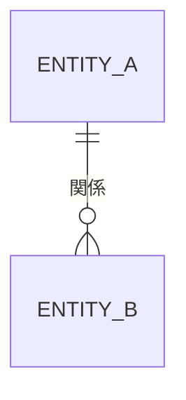

# テーブル一覧

<!-- テンプレート：DOC-204 DB設計書（一覧ファイル）／責務：データは、どのテーブルに、どの構造・制約で保存されるか。／書き方は 01_作成ガイド/DB設計書作成ガイド.md を参照 -->

## 1. 目的

（記載する）

## 2. 対象範囲

| 区分 | 内容 |
|----|----|
| 対象 |  |
| 対象外 |  |

## 3. 前提・制約

- なし

## 4. 仕様

### 4.1 論理ER図

<!-- テーブル間の関係 -->

### 4.2 テーブル一覧

<!-- テーブルID（TBL）、論理名、物理名、概要、対応エンティティ（ENT）、件数見込み -->

| テーブルID | 論理名 | 物理名 | 概要 | ENT ID | 件数見込み |
|------------|------|------|----|------------|----------|
|  |  |  |  |  |  |

### 4.3 命名規則

<!-- テーブル・カラム・インデックスの物理名の規則 -->

| 対象 | 規則 | 例 |
|----|----|---|
| テーブル |  |  |
| カラム |  |  |
| 主キー |  |  |
| 外部キー |  |  |
| インデックス |  |  |

### 4.4 共通カラム

<!-- 作成日時、更新日時、作成者、論理削除フラグなど -->

| 論理名 | 物理名 | 型 | 説明 |
|------|------|---|----|
|  |  |  |  |

### 4.5 コード値の物理定義

<!-- コード値の格納方式（コードテーブル、列挙型など）（条件付き：該当時、詳細設計で記載） -->

| コード種別 | 格納方式 | 格納先 |
|----------|--------|------|
|  |  |  |

## 5. 関連資料

| ID | 資料名 | 関係 |
|----|------|----|
|  |  |  |

## 6. 未確定事項

| 課題ID | 内容 | 影響範囲 | 担当 | 期限 | 状態 | 決定内容 |
|--------|----|--------|----|----|----|--------|
|  |  |  |  |  |  |  |

## 7. 変更履歴

| バージョン | 日付 | 変更内容 | 変更者 |
|----------|----|--------|------|
| 0.1.0 | YYYY-MM-DD | 初版作成 |  |
