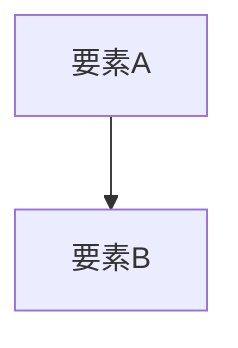

# 画面一覧

<!-- テンプレート：DOC-202 画面設計書（一覧ファイル）／責務：画面には、何が表示され、利用者が操作すると何が起きるか。／書き方は 01_作成ガイド/画面設計書作成ガイド.md を参照 -->

## 1. 目的

（記載する）

## 2. 対象範囲

| 区分 | 内容 |
|----|----|
| 対象 |  |
| 対象外 |  |

## 3. 前提・制約

- なし

## 4. 仕様

### 4.1 画面一覧

<!-- 画面ID（SCR）、画面名、概要、対応機能（FNC）、利用ロール -->

| 画面ID | 画面名 | 概要 | 機能ID | 利用ロール |
|--------|------|----|--------|----------|
|  |  |  |  |  |

### 4.2 画面遷移図

<!-- 画面間の遷移と遷移条件 -->



### 4.3 共通レイアウト

<!-- ヘッダー・メニュー・フッターなど全画面共通の構成（条件付き：複数画面） -->

```text
+------------------------------------------+
| （領域・項目の配置を記載する）           |
+------------------------------------------+
```

### 4.4 共通仕様

<!-- 共通の入力チェック方針、ページング、日付表示形式、二重送信防止 -->

| 項目 | 内容 |
|----|----|
| 入力チェックの方針 |  |
| ページング |  |
| 日付・数値の表示形式 |  |
| 二重送信防止 |  |

## 5. 関連資料

| ID | 資料名 | 関係 |
|----|------|----|
|  |  |  |

## 6. 未確定事項

| 課題ID | 内容 | 影響範囲 | 担当 | 期限 | 状態 | 決定内容 |
|--------|----|--------|----|----|----|--------|
|  |  |  |  |  |  |  |

## 7. 変更履歴

| バージョン | 日付 | 変更内容 | 変更者 |
|----------|----|--------|------|
| 0.1.0 | YYYY-MM-DD | 初版作成 |  |
