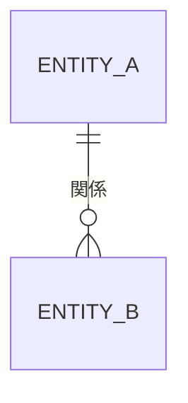
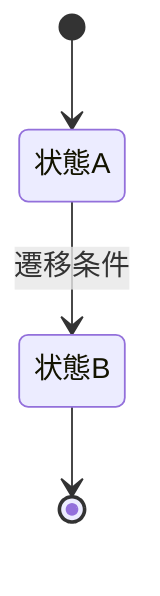

# データ要件定義書

<!-- テンプレート：DOC-105 データ要件定義書／責務：システムは、どのようなデータを、どのような意味と関係で扱うか。／書き方は 01_作成ガイド/データ要件定義書作成ガイド.md を参照 -->

## 1. 目的

（記載する）

## 2. 対象範囲

| 区分 | 内容 |
|----|----|
| 対象 |  |
| 対象外 |  |

## 3. 前提・制約

- なし

## 4. 仕様

### 4.1 エンティティ一覧

<!-- エンティティID（ENT）、名称、定義、発生源、保持期間、件数見込み -->

| ENT ID | エンティティ名 | 定義 | 発生源 | 保持期間 | 件数見込み |
|------------|--------------|----|------|--------|----------|
|  |  |  |  |  |  |

### 4.2 概念ER図

<!-- エンティティ間の関係（多重度） -->

### 4.3 主要属性

<!-- エンティティの主要な属性と業務上の意味 -->

| ENT ID | 属性名 | 業務上の意味 |
|------------|------|------------|
|  |  |  |

### 4.4 データ項目辞書（ドメイン）

<!-- 共通的に使う項目の型・桁・形式（例：メールアドレス、金額、電話番号）の論理定義 -->

| ドメイン名 | 型 | 桁 | 形式・制約 | 例 |
|----------|---|---|----------|---|
|  |  |  |  |  |

### 4.5 状態遷移

<!-- 状態を持つエンティティの状態と遷移条件（例：注文ステータス）（条件付き：該当時） -->

| 状態 | 遷移先 | 遷移条件 |
|----|------|--------|
|  |  |  |

### 4.6 コード定義

<!-- 区分値・コード値の論理定義（値と意味）（条件付き：該当時） -->

| コード種別 | 値 | 意味 | 並び順 |
|----------|---|----|------|
|  |  |  |  |

### 4.7 データの取り扱い区分

<!-- 個人情報・機密情報の該当有無 -->

| ENT ID | 個人情報 | 機密情報 | 備考 |
|------------|--------|--------|----|
|  |  |  |  |

## 5. 関連資料

| ID | 資料名 | 関係 |
|----|------|----|
|  |  |  |

## 6. 未確定事項

| 課題ID | 内容 | 影響範囲 | 担当 | 期限 | 状態 | 決定内容 |
|--------|----|--------|----|----|----|--------|
|  |  |  |  |  |  |  |

## 7. 変更履歴

| バージョン | 日付 | 変更内容 | 変更者 |
|----------|----|--------|------|
| 0.1.0 | YYYY-MM-DD | 初版作成 |  |
