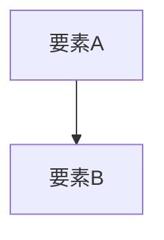

# 業務フロー図

<!-- テンプレート：DOC-102 業務フロー図／責務：業務は、誰が、どの順で、どこでシステムを使って進めるか。／書き方は 01_作成ガイド/業務フロー図作成ガイド.md を参照 -->

## 1. 目的

（記載する）

## 2. 対象範囲

| 区分 | 内容 |
|----|----|
| 対象 |  |
| 対象外 |  |

## 3. 前提・制約

- なし

## 4. 仕様

### 4.1 業務プロセス一覧

<!-- 業務ID（BIZ）、業務名、概要、頻度 -->

| 業務ID | 業務名 | 概要 | 頻度 | アクター |
|--------|------|----|----|--------|
|  |  |  |  |  |

### 4.2 業務フロー図

<!-- アクター別のスイムレーン図（As-Is は任意、To-Be は必須） -->

### 4.3 業務とシステム機能の対応

<!-- 各ステップで使う機能（FNC） -->

| 業務ID | ステップ | 機能ID |
|--------|--------|--------|
|  |  |  |

### 4.4 例外業務

<!-- 例外・差し戻し時の流れ（条件付き：該当時） -->

（記載する）

## 5. 関連資料

| ID | 資料名 | 関係 |
|----|------|----|
|  |  |  |

## 6. 未確定事項

| 課題ID | 内容 | 影響範囲 | 担当 | 期限 | 状態 | 決定内容 |
|--------|----|--------|----|----|----|--------|
|  |  |  |  |  |  |  |

## 7. 変更履歴

| バージョン | 日付 | 変更内容 | 変更者 |
|----------|----|--------|------|
| 0.1.0 | YYYY-MM-DD | 初版作成 |  |
