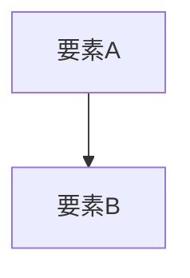

# モジュール構成設計書

<!-- テンプレート：DOC-302 モジュール構成設計書／責務：ソフトウェアの内部は、どの単位に分かれ、どのように依存するか。／書き方は 01_作成ガイド/モジュール構成設計書作成ガイド.md を参照 -->

## 1. 目的

（記載する）

## 2. 対象範囲

| 区分 | 内容 |
|----|----|
| 対象 |  |
| 対象外 |  |

## 3. 前提・制約

- なし

## 4. 仕様

### 4.1 アーキテクチャ方針

<!-- 採用するアーキテクチャスタイル（レイヤード、クリーンアーキテクチャなど）と理由 -->

（記載する）

### 4.2 モジュール一覧

<!-- モジュールID（MOD）、名称、責務、配置（リポジトリ・ディレクトリ） -->

| MOD ID | モジュール名 | 責務 | 配置 |
|------------|------------|----|----|
|  |  |  |  |

### 4.3 依存関係

<!-- モジュール間の依存関係図と依存のルール（禁止する依存） -->



| No | 依存のルール |
|----|------------|
|  |  |

### 4.4 ディレクトリ構成

<!-- ソースコードのディレクトリ構成 -->

```text

```

### 4.5 共通部品

<!-- 共通部品の一覧と用途（条件付き：該当時） -->

| 部品名 | 用途 | MOD ID |
|------|----|------------|
|  |  |  |

### 4.6 共通方式の実装

<!-- DOC-201 の共通方式（ログ、例外など）をどのモジュールで実現するか -->

| 共通方式 | 実現モジュール | 備考 |
|--------|--------------|----|
| ログ出力 |  |  |
| 例外処理 |  |  |
| トランザクション |  |  |
| 日時・タイムゾーン |  |  |
| 採番 |  |  |

## 5. 関連資料

| ID | 資料名 | 関係 |
|----|------|----|
|  |  |  |

## 6. 未確定事項

| 課題ID | 内容 | 影響範囲 | 担当 | 期限 | 状態 | 決定内容 |
|--------|----|--------|----|----|----|--------|
|  |  |  |  |  |  |  |

## 7. 変更履歴

| バージョン | 日付 | 変更内容 | 変更者 |
|----------|----|--------|------|
| 0.1.0 | YYYY-MM-DD | 初版作成 |  |
