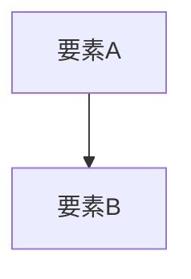

# 処理設計書 PRC-xxx 〇〇〇

<!-- テンプレート：DOC-301 処理設計書（個別ファイル）／責務：処理は、内部でどの順に、どのルールで、どのデータを操作するか。／書き方は 01_作成ガイド/処理設計書作成ガイド.md を参照 -->

## 1. 目的

（記載する）

## 2. 対象範囲

| 区分 | 内容 |
|----|----|
| 対象 |  |
| 対象外 |  |

## 3. 前提・制約

- なし

## 4. 仕様

### 4.1 処理概要

<!-- 目的、起動元、対応機能 -->

| 項目 | 内容 |
|----|----|
| 処理ID |  |
| 処理名 |  |
| 目的 |  |
| 起動元 |  |
| 機能ID |  |

### 4.2 入力・出力

<!-- 入力データと出力データ（画面・API項目、テーブル、ファイル） -->

| 区分（入力／出力） | データ | 参照先 |
|------------------|------|------|
|  |  |  |

### 4.3 処理フロー

<!-- 処理手順（フローチャート、シーケンス図） -->

### 4.4 業務ルール・計算式

<!-- 判定条件、計算式、丸め規則（デシジョンテーブル推奨）（条件付き：該当時） -->

| No | 条件 | 結果 |
|----|----|----|
|  |  |  |

### 4.5 データ操作

<!-- 操作するテーブルと CRUD、抽出条件（条件付き：該当時） -->

| テーブルID | 操作（C/R/U/D） | 条件 |
|------------|----------------------|----|
|  |  |  |

### 4.6 トランザクション

<!-- トランザクション境界、排他制御（楽観／悲観ロック）（条件付き：更新あり） -->

| 項目 | 内容 |
|----|----|
| トランザクション境界 |  |
| 排他制御 |  |

### 4.7 例外処理

<!-- 例外の種類、検知方法、処理（ロールバック、リトライ、通知）、メッセージID -->

| No | 例外 | 検知方法 | 処理 | メッセージID |
|----|----|--------|----|--------------|
|  |  |  |  |  |

### 4.8 性能上の考慮

<!-- 処理件数、目標時間、大量データ時の分割方針（条件付き：バッチ） -->

| 項目 | 内容 |
|----|----|
| 想定件数 |  |
| 目標時間 |  |
| 分割方針 |  |

### 4.9 再実行

<!-- 再実行の可否、手順、冪等性（条件付き：バッチ） -->

| 項目 | 内容 |
|----|----|
| 再実行の可否 |  |
| 再実行手順 |  |
| 冪等性 |  |

## 5. 関連資料

| ID | 資料名 | 関係 |
|----|------|----|
|  |  |  |

## 6. 未確定事項

| 課題ID | 内容 | 影響範囲 | 担当 | 期限 | 状態 | 決定内容 |
|--------|----|--------|----|----|----|--------|
|  |  |  |  |  |  |  |

## 7. 変更履歴

| バージョン | 日付 | 変更内容 | 変更者 |
|----------|----|--------|------|
| 0.1.0 | YYYY-MM-DD | 初版作成 |  |
