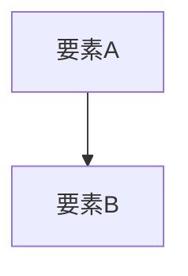

# 運用設計書

<!-- テンプレート：DOC-501 運用設計書／責務：稼働後のシステムを、誰が、いつ、どう見守り、どう戻すか。／書き方は 01_作成ガイド/運用設計書作成ガイド.md を参照 -->

## 1. 目的

（記載する）

## 2. 対象範囲

| 区分 | 内容 |
|----|----|
| 対象 |  |
| 対象外 |  |

## 3. 前提・制約

- なし

## 4. 仕様

### 4.1 運用体制

<!-- 運用担当、連絡体制、対応時間帯 -->

| 役割 | 担当 | 連絡先 | 対応時間帯 |
|----|----|------|----------|
|  |  |  |  |

### 4.2 監視

<!-- 監視項目、閾値、検知時の通知先・対応 -->

| 監視項目 | 閾値 | 通知先 | 対応 |
|--------|----|------|----|
|  |  |  |  |

### 4.3 ジョブスケジュール

<!-- バッチ（BAT）の実行スケジュール、実行順序（条件付き：バッチあり） -->

| BAT ID | 実行タイミング | 実行順序 | 失敗時の対応 |
|------------|--------------|--------|------------|
|  |  |  |  |

### 4.4 バックアップ・リストア

<!-- 対象、頻度、保持世代、リストア手順 -->

| 対象 | 頻度 | 保持世代 | リストア手順 |
|----|----|--------|------------|
|  |  |  |  |

### 4.5 障害対応

<!-- 障害レベル、対応フロー、復旧手順 -->

| 障害レベル | 定義 | 対応 | 連絡先 |
|----------|----|----|------|
|  |  |  |  |

### 4.6 定常運用作業

<!-- 日次・月次などの作業（OPS ID）、手順（条件付き：該当時） -->

| OPS ID | 作業名 | 頻度 | 手順 |
|------------|------|----|----|
|  |  |  |  |

### 4.7 ログ運用

<!-- ログの保管期間、ローテーション、参照方法 -->

| ログ種別 | 保管期間 | ローテーション | 参照方法 |
|--------|--------|--------------|--------|
|  |  |  |  |

## 5. 関連資料

| ID | 資料名 | 関係 |
|----|------|----|
|  |  |  |

## 6. 未確定事項

| 課題ID | 内容 | 影響範囲 | 担当 | 期限 | 状態 | 決定内容 |
|--------|----|--------|----|----|----|--------|
|  |  |  |  |  |  |  |

## 7. 変更履歴

| バージョン | 日付 | 変更内容 | 変更者 |
|----------|----|--------|------|
| 0.1.0 | YYYY-MM-DD | 初版作成 |  |
