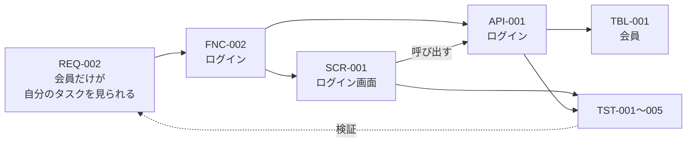

# 記載例

すべての記載例は、同じ題材で作成している。ID のつながり（要件 → 機能 → 画面・API・テーブル → テスト）を、ファイルをまたいでたどれるようにするためである。

## 題材：個人向けタスク管理Webアプリ「TaskNote」

| 項目 | 内容 |
|------|------|
| 概要 | 個人が期限付きのタスクを登録・確認する Web アプリ |
| 規模 | S（開発者1名、機能4、期間3か月） |
| 主な機能 | FNC-001 会員登録／FNC-002 ログイン／FNC-003 タスク登録／FNC-004 タスク一覧表示 |

## 記載例の一覧

| 記載例 | 設計書 | 見どころ |
|--------|--------|----------|
| [プロジェクト概要書_サンプル](プロジェクト概要書_サンプル.md) | DOC-001 | 対象外の明記、測定できる成功基準 |
| [設計書適用台帳_サンプル](設計書適用台帳_サンプル.md) | DOC-002 | 規模Sでの設計書の選び方、統合・省略の理由 |
| [要件定義書_サンプル](要件定義書_サンプル.md) | DOC-101 | 非機能要件・データ要件の統合、受入条件 |
| [機能一覧_サンプル](機能一覧_サンプル.md) | DOC-103 | 要件と要素ID のつながり |
| [画面設計書_サンプル](画面設計書_サンプル.md) | DOC-202 | SCR-001 ログイン画面。ドメイン参照、エラー時の振る舞い |
| [API設計書_サンプル](API設計書_サンプル.md) | DOC-203 | API-001 ログイン。エラーコードの列挙 |
| [DB設計書_サンプル](DB設計書_サンプル.md) | DOC-204 | TBL-001 会員。論理と物理の分離 |
| [テスト仕様書_サンプル](テスト仕様書_サンプル.md) | DOC-402 | 要件ID との対応、判定できる期待結果 |

## ID のつながり

記載例は説明用の架空のアプリであり、実在のサービスとは関係ない。
